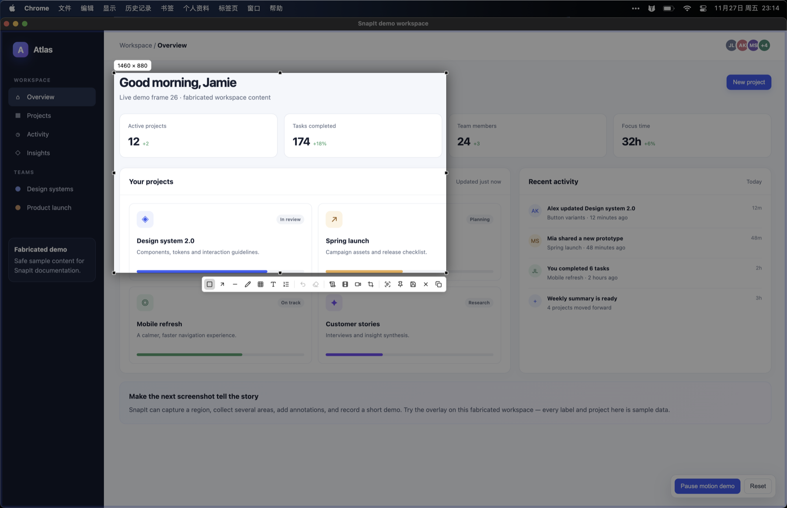
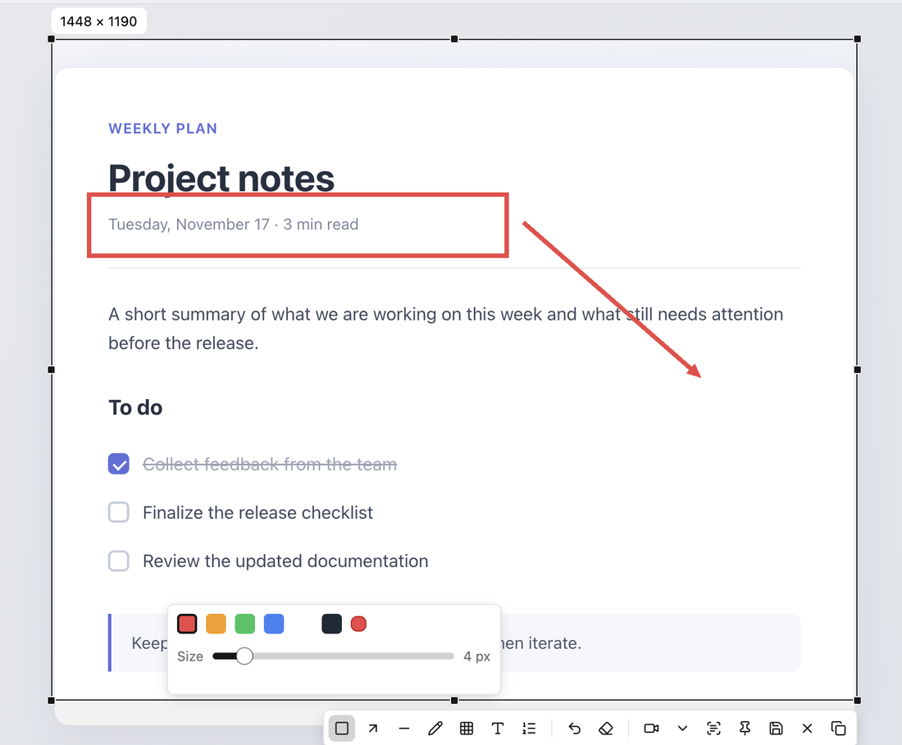
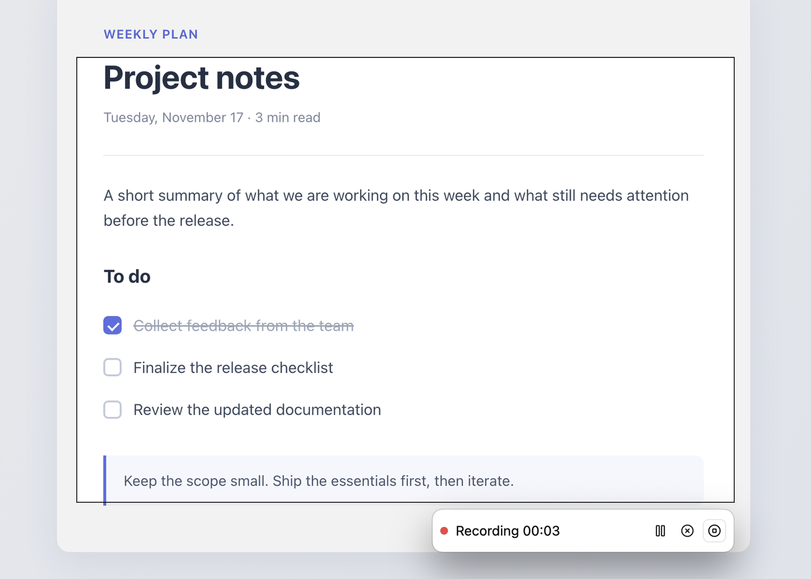

<p align="center">
  
</p>

<h1 align="center">SnapIt</h1>

<p align="center">
  English | <a href="README.md">简体中文</a>
</p>

<p align="center">
  <a href="https://github.com/gjfei/snapit/releases/latest"></a>
</p>

SnapIt is a native screenshot tool for macOS and Windows, written in Rust with [gpui-kit](https://github.com/longbridge/gpui-kit) (Zed's GPUI) — no Electron, no WebView. It lives in the tray with no main window or launcher: a global shortcut freezes every display, and the overlay lets you copy, save, pin, recognize text or record a GIF / APNG / MP4 from the selection.

<p align="center">
  
</p>
<p align="center"><sub>Selection overlay and toolbar · all demo data in the previews below is fictional</sub></p>

## Features

- **Multi-monitor region capture**: the whole desktop freezes and each display gets a fullscreen overlay. Drag a region, or hover a window / UI element and click to snap to it.
- **Multiple regions and quick keys**: `F` selects the whole current display, `C` copies the color under the cursor (`#RRGGBB`). Hold `Shift` to collect: click or drag to add regions, click a selected region to remove it. Releasing `Shift` combines same-display regions into one selection that can be annotated; copy / save / pin use the combined image with each region at its original on-screen position and the rest transparent in PNG.
- **Window and element snapping**: highlight the window under the cursor; with element snapping on, the smallest control is highlighted and the wheel moves up through its containers.
- **Annotations & free crop**: rectangle, arrow, line, pen, mosaic, text and numbered steps, with 6 colors and adjustable widths; `⌘Z` / `Ctrl+Z` to undo, plus one-click clear. Press `E` or click Crop in the overlay toolbar to open the crop & edit window for 2D free cropping, further annotation and zoom before Copy / Save / Pin / OCR (preserving HDR when unannotated).
- **Watermarks**: design multi-element stamps in a dedicated three-pane designer window combining multi-line text (with `{date}` / `{time}` / `{datetime}` / `{year}` variables, bold, drop shadow, outline stroke and pill background) and multiple PNG / JPEG images (with rounded corners). Drag, corner-resize, top-handle rotate (`Shift` snaps 15°), align with snap guides, undo/redo, drop files or paste clipboard images directly over a theme-following transparent checkerboard, or start from 5 built-in starters. Settings offers one watermark dropdown per output (Screenshots / Animations / Videos, including "Don't use"); the Manage button at the page header's right edge opens the designer, whose top template bar switches, creates, duplicates, renames and deletes templates. Watermarks are off by default (all outputs set to "Don't use"); OCR always recognizes the clean image without annotations or watermarks.
- **Copy and save**: copy as PNG; save as PNG or JPEG (with adjustable JPG quality), or change the extension in the save dialog.
- **HDR capture**: when the display is in HDR and the frame actually exceeds SDR white, Save, Copy and the history original keep the same 16-bit PNG tagged with cICP (BT.2020 / PQ). Annotations and watermarks on a single-region capture are composited in linear HDR and preserve HDR; selection previews, pins, OCR, GIF and history thumbnails use SDR. Cross-display multi-region stitching remains 8-bit, and JPEG does not carry HDR. With HDR recording enabled and supported, MP4 is encoded as HDR10 (HEVC Main 10, PQ / BT.2020), and watermarks never silently downgrade it; only an unavailable encoder falls back to SDR / H.264 with the watermark retained. macOS needs 15+ on Apple Silicon; Windows needs an HDR-enabled display.
- **Pins**: keep a capture on screen, movable, zoomable and translucent; multiple pins are supported, and tall captures automatically open as scrollable tiled pins.
- **Scrolling screenshot**: stitch manually upward or downward right after selecting a region, or use the control bar's Up / Down buttons to start or switch adaptive auto-scroll. Sustained reverse manual scrolling takes over and stops auto-scroll. The stitcher keeps textured sticky headers/footers only once (ignoring plain whitespace), detects static left/right sidebars (keeping them once at the top and seamlessly extending their background and divider below while restricting motion matching to the scrolling center), excludes scrollbar margins and aligns cleanly across overlaps. The live preview requests only its visible range instead of accumulating tiles, and all annotation tools work during capture; existing annotations stay anchored when content is prepended. Finish with Copy / Save / Pin / OCR, or press `E` to open the crop & edit window for 2D free cropping and further annotation (auto-saved to history on close). Images taller than 4096 px use striped OCR with seam deduplication; very tall history images get a cropped local thumbnail.
- **Text recognition**: recognizes the selection and copies the text when it can; the results panel lets you copy again, and the text is stored in history.
- **Video / animation recording (GIF and APNG)**: the overlay toolbar and tray expose separate Animation and Video actions. Animation uses the format chosen in Settings (GIF by default), with no repeated format picker at the recording entry points. GIF drops straight into a chat, APNG keeps full lossless RGBA quality in a `.png` animation, and MP4 goes through the system hardware encoder and stays small and smooth. The cursor and click effects are on by default. Settings offers 22 effects in Basic, Motion, Particles and Glow groups, including a diamond outline, corner brackets, orbiting dots, radar sweep, stardust, a micro rocket, nebula glow and a rainbow ring. Compact category tabs save vertical space, and clicking a style card plays a one-shot preview at the clicked position, hides the static thumbnail while it plays, and restores the thumbnail after 1.2 seconds without another click. Click effects require cursor capture and are drawn before duplicate-frame detection, so they still animate over a static screen. Recording captures, encodes and writes on a dedicated thread; GIF / APNG use a bounded queue sized for the physical resolution, and changed frames get a sampled prefilter before exact deduplication without reducing output pixels. Every format shows a control bar with pause / resume, cancel and stop; the shortcut, Stop or the duration limit saves the recording, while `Esc` or Cancel discards it.
- **Tray and global shortcuts**: `⌥⇧A` capture, `⌥⇧S` scrolling screenshot, `⌥⇧O` recognize text, `⌥⇧G` record an animation, `⌥⇧V` record a video by default. Rebind them in settings; conflicts are reported.
- **History**: copy, save, pin, OCR and recorded GIFs / APNGs / videos are all saved automatically, pruned by item count (0 keeps everything).
- **Permission guidance**: when macOS screen recording or accessibility access is missing, SnapIt opens a permissions panel that explains what each one is for and links to System Settings.
- **Small and native**: a single executable, light / dark themes that follow the system, Simplified Chinese and English UI.

## How it differs

- **Tray-only**: no main window, launcher or always-open window. Settings, history and OCR results are panels opened on demand.
- **Region-only recording**: GIF / APNG / MP4 recording covers the selection; no camera, microphone or picture-in-picture.
- **Element snapping needs a system accessibility API**: available on macOS and Windows.
- **Built-in updater**: checks GitHub Releases after launch (can be disabled in Settings) and on demand from the tray or app menu; pre-releases are included, and every download is verified against SHA-256. Windows installs and restarts; macOS saves the verified DMG to Downloads and reveals it in Finder — drag it into Applications.
- **Windows has an installer**: `setup.exe` installs to `Program Files` with an uninstall entry and is also used for in-app updates; macOS uses DMG / zip.

## Download and install

Download the file for your platform from [GitHub Releases](https://github.com/gjfei/snapit/releases/latest) (`<version>` is the version number):

| Platform | File |
| --- | --- |
| macOS Apple silicon | `SnapIt-<version>-macos-aarch64.dmg` or `.zip` |
| macOS Intel | `SnapIt-<version>-macos-x86_64.dmg` or `.zip` |
| Windows x64 | `SnapIt-<version>-windows-x86_64-setup.exe` |
| Windows ARM64 | `SnapIt-<version>-windows-aarch64-setup.exe` |

Each release also includes `SHA256SUMS.txt` with the checksums of all files and an update manifest, `latest.json`. SnapIt checks it after launch (pre-releases included), or on demand from the tray menu or Settings → General → Updates; a manual first install on macOS still needs the Gatekeeper step described below.

### macOS

- Requires macOS 13 or later.
- Release builds are ad-hoc signed and not notarized by Apple by default. On first launch, **right-click the app in Applications → Open**; or run:

  ```sh
  xattr -dr com.apple.quarantine "/Applications/SnapIt.app"
  ```

- **Move the app to Applications before running it**, otherwise Screen Recording permission and notifications attach to the terminal or IDE instead.
- Before the first capture, enable **SnapIt** in **System Settings → Privacy & Security → Screen & System Audio Recording**. Element snapping also needs **Accessibility**. After granting Screen Recording you may need to restart SnapIt.
- When running `cargo run -p snapit` from a terminal or IDE, the permissions belong to that terminal / IDE (Terminal, iTerm, Cursor, …), not to SnapIt.

### Windows

- Run `SnapIt-<version>-windows-<arch>-setup.exe`; it installs to `Program Files\SnapIt` (administrator required), creates a Start Menu shortcut and offers an optional desktop shortcut. The install directory can be changed in the wizard and is reused on the next install.
- In-app updates download and run the newer `setup.exe` silently (administrator permission required); running it manually over the installed version works too. Configuration and history are preserved. If SnapIt is running, interactive setup and the uninstaller ask first; an in-app silent update closes it outright — configuration and history are written immediately.
- The executable is not code-signed, so SmartScreen may warn about an unrecognized app — choose **More info → Run anyway**.
- Capture and element snapping need no extra permission; element snapping uses the Windows accessibility API.
- Uninstall from Settings → Apps → Installed apps → SnapIt, or run `Program Files\SnapIt\uninstall.exe`. Configuration and history are left in place.

## Usage

### Tray and global shortcuts

On launch SnapIt only shows a tray icon (the menu bar on macOS). The tray menu contains Screenshot, Scrolling Screenshot, Animation, Video, Recognize Text, Pin Last Capture, History, Settings and Quit. The animation format is configured in Settings and defaults to GIF. Closing settings, history, OCR results, a pin or the overlay never quits the app. On macOS there is normally no Dock icon; it appears only while the settings, history, OCR panel or long-image editor is open.

Default global shortcuts:

| Action | Default shortcut |
| --- | --- |
| Capture region | `⌥⇧A` (`Alt+Shift+A` on Windows) |
| Scrolling screenshot | `⌥⇧S` (`Alt+Shift+S`) |
| Recognize text | `⌥⇧O` (`Alt+Shift+O`) |
| Record animation | `⌥⇧G` (`Alt+Shift+G`) |
| Record video | `⌥⇧V` (`Alt+Shift+V`) |

Rebind them in **Settings → Shortcuts** by clicking and pressing a new combination; `Esc` aborts the rebinding and `Backspace` / `⌫` clears (disables) a binding. Unsupported combinations, conflicts with another action and shortcuts the system refuses to register are reported. While recording or capturing a scrolling screenshot, any global shortcut finishes the current task (scrolling capture completes and copies), and pressing a different shortcut queues and runs its action once done.

Only one SnapIt process runs per data directory, so the tray icon and global hotkeys are never duplicated. A second launch without flags simply exits; `--capture` / `--settings` / `--history` are forwarded to the running instance through `snapit.request` in the data directory and executed there (within about 50 ms) instead of being silently dropped. The login item's `--background` launch has no request and does not open another window.

### Capturing

1. Press the capture shortcut, or choose Screenshot in the tray. Every display freezes immediately and an overlay opens on each monitor.
2. Drag to select a region; after releasing, drag the edges or handles to resize.
3. Press `Enter` or double-click inside the selection to copy, or use a toolbar button. `Esc` or right-click cancels; with a selection active, right-click clears the selection first.
4. `⌘C` / `Ctrl+C` copies, `⌘S` / `Ctrl+S` saves. The clipboard always receives a PNG.
5. `F` selects the whole current display; `C` copies the color under the cursor (`#RRGGBB`, also shown in the magnifier).
6. Hold `Shift` to enter multi-select: click windows / elements or drag to add regions, click a selected region to remove it. Releasing `Shift` combines same-display regions into one selection that can be annotated, copied, saved and pinned: each region keeps its original on-screen position and the rest is transparent in PNG. A combined selection cannot be resized and does not support recording; hold `Shift` again to restore the separate regions for further edits. Regions on different displays are stitched top to bottom and stay separate (no annotations or recording).

<p align="center">
  
</p>
<p align="center"><sub>Hold Shift to collect regions one by one, then release to combine them</sub></p>

The save dialog suggests `SnapIt <date> <time>.<extension>`, and the directory is, in order: the configured save directory → `~/Pictures` → `~/Desktop` → the home directory. Image format and JPG quality live in **Settings → Capture**; changing the extension to `.jpg` / `.jpeg` in the dialog saves as JPEG.

With no selection, hovering highlights the window under the cursor; with element snapping, the smallest control is highlighted, the wheel moves outward to containers and reverses back. Clicking the highlight selects it.

### Scrolling screenshot

1. Press the scrolling screenshot shortcut (`⌥⇧S` / `Alt+Shift+S` by default), choose **Scrolling Screenshot** in the tray, or click the scroll capture button on the selection overlay toolbar (single-display, single-region selections only).
2. The overlay immediately switches to a click-through live border while opening a compact floating control bar and a live long-image preview (togglable from the bar or in Settings). Scroll manually with the mouse wheel or trackpad in either direction, or click the control bar's Up / Down buttons to auto-scroll in that direction. While auto-scroll is active, click the other direction to switch; `Space` toggles the current direction. Sustained reverse manual scrolling takes over and stops auto-scroll, as does reaching the current boundary. There is no fixed pixel-height limit.
3. The stitcher ignores scrollbar margins, automatically keeps textured sticky headers and footers only once (never misclassifying blank whitespace), and cuts seams near the middle of overlap bands. If you scroll too fast or hit a blank low-texture stretch, the live outline switches to a warning color and pauses stitching until you scroll back into overlap.
4. Choose **Annotate in the scrolling region** to pause scrolling and draw directly in the real selection with rectangle, arrow, line, pen, mosaic, text and numbered-step tools, including undo, deletion and style controls. **Done** restores the previous auto-scroll direction; a manually paused capture stays paused. Prepending content or resizing fixed bars keeps existing annotation anchors attached to their content. The live preview remains read-only. The control bar provides **Reset**, **auto-scroll direction**, **Live Preview**, and direct **Copy** (`Enter`), **Save** (`⌘S` / `Ctrl+S`), **Pin** and **OCR** actions. Press `E` for the **Long-Image Editor**; `Esc` or Cancel discards the capture.
5. **Long-image editor**: lazily loads visible GPU tiles under a byte budget, with draggable top/bottom trim handles, all 7 annotation tools, zoom controls (`Fit width` / `100%`), and direct Copy / Save / Pin / OCR actions.

### Annotations

Once a region is selected, annotation tools appear on the left of the toolbar:

| Tool | Notes |
| --- | --- |
| Rectangle | Line width 2 / 4 / 8 px |
| Arrow | Line width 2 / 4 / 8 px |
| Pen | Freehand |
| Mosaic | Real pixelation; no color |
| Text | Click to place, then type; `Enter` confirms, `Esc` cancels |
| Step | Places numbered circles 1, 2, 3… |

<p align="center">
  
</p>
<p align="center"><sub>Rectangle, arrow, pen, mosaic, text and step annotations, with color and line width</sub></p>

Everything except mosaic takes a color; rectangle, arrow and pen also take a line width. Undo and clear buttons sit on the same toolbar, which can be dragged and stays where you drop it. Annotations live on the frozen screenshot: copy, save and pin bake them into the image, while OCR and recording use the unannotated selection. Watermarks sit above annotations, and Copy, Save, Pin and the history original share one frozen composed result.

### Watermarks

In **Settings → Watermark**, pick a saved template for Screenshots, Animations and Videos independently; choose **Don't use** to skip an output, which is the default for all three. Click **Manage** at the right edge of the page header to open the dedicated three-pane designer. Its top template bar switches between saved templates and creates, duplicates, renames or deletes them; creating one starts from 5 built-in starters (Blank, Clean signature, Brand + timestamp, Pill badge, Diagonal tile). The toolbar adds multiple multi-line text elements (with `{date}`, `{time}`, `{datetime}` and `{year}` variables, bold, drop shadow, outline stroke and pill background) and multiple PNG / JPEG images (with corner radius cropping), plus undo / redo, duplicate, delete and alignment / distribution actions. The left pane lists layers alongside the **Whole** toggle, the center canvas uses a theme-following transparent checkerboard and supports direct dragging with 5 px sibling snap guides, corner resize handles, top rotation handle (`Shift` snaps 15°), trackpad pinch or scroll zoom, drag-and-drop image import and `⌘V` / `Ctrl+V` clipboard image paste, and the right inspector edits styling and exact coordinates. **Layout & Preview** adjusts the clickable 3×3 placement grid, tiling and spacing, and non-tiled non-centered margins can be dragged directly on that canvas. Editing is draft-only: **Save Template** writes the stamp design, while Cancel leaves the original untouched; switching templates with unsaved changes asks for confirmation first. Template names are unique and searchable, and deleting a template returns its outputs to "Don't use".

The **Apply To** group has one dropdown each for screenshots, animations (GIF / APNG) and videos (MP4); pick a saved template or leave it at **Don't use**, which is the default for all three.

Each output keeps its own template selection with no master switch and no shared-template concept; to temporarily disable one, set it back to **Don't use**. Template names, designer fields and output types are included in Settings search. Template edits update the active screenshot selection preview immediately. The designer's layout preview frame is always 16:9, while representative screenshot, square animation and 16:9 video canvases fit inside it without cropping; square canvases are centered with side padding. Watermarks use a new template-based configuration; old inline fields are ignored rather than migrated.

Enabled animation and video recordings bake in the watermark for their output type before encoding. The watermark is composited after the cursor / click effects and after exact duplicate-frame detection, and is rasterized only once, so a static watermark never changes deduplication or stacks on itself. HDR MP4 composites directly into linear HDR before BT.2020 / PQ Main10 conversion.

Imported images are checked for format, dimensions and file size, then copied into the app data directory's `watermarks/` folder; the config stores only the managed file name. Watermark processing stays local. History originals and pins opened from history retain the pixels captured at creation time: later settings changes do not recompose them, and copying or saving again never adds a second watermark. OCR always receives the clean SDR source.

### Text recognition

Press the OCR shortcut, choose Recognize Text in the tray, or click the recognize button in the overlay toolbar. Recognition starts as soon as the region is committed and opens a small results panel:

- A result is **copied to the clipboard automatically**.
- The panel can copy the text again; no text, a failed recognition or an unavailable backend is reported in the panel.
- Recognition uses the original selection, without annotations or watermarks; the image stored in history still matches Copy and Save.

Choose the language in **Settings → Text Recognition**: automatic (Simplified Chinese, Traditional Chinese, English) or an explicit Simplified Chinese, Traditional Chinese, English, Japanese, Korean, French or German. The setting applies to macOS Vision and Windows.Media.Ocr; the ocrs backend only supports Latin script, so the setting does not change its results.

| Backend | Platform | Notes |
| --- | --- | --- |
| Apple Vision | macOS | Default; no models needed |
| Windows.Media.Ocr | Windows | Default; needs the matching OCR language pack, falls back to ocrs if creation fails |
| [ocrs](https://github.com/robertknight/ocrs) | All | Pure Rust, Latin script only, needs downloaded models |

<p align="center">
  
</p>
<p align="center"><sub>Results panel: a result is copied automatically and can be copied again</sub></p>

### Video / animation recording (GIF / APNG)

1. Press the animation or video shortcut, choose Animation or Video in the tray, or click the matching overlay toolbar button. Every animation entry uses the GIF or APNG format selected in **Settings → Recording → Animation format**, defaulting to GIF.
2. Recording starts as soon as the region is committed: an outline frames the selection (it sits just outside the captured area, so it never appears in the recording) and a control bar beside it shows the elapsed time and, when set, the duration limit. The bar has three icon-only buttons — pause / resume, cancel and stop (hover for a tooltip); it can be dragged and stays where you drop it. SnapIt's own windows never appear in the recording, so dropping it over the selection is fine.
3. `Space` pauses or resumes: paused frames are not encoded, and the paused stretch is left out of both the file's timeline and the duration limit. Any global shortcut, the bar's stop icon (or `Enter`), or reaching the limit ends and saves the recording; the bar then shows the selected format while encoding. When a shortcut stopped it, that shortcut's action starts automatically after encoding. `Esc` or the cancel icon discards the recording outright: no file, no history entry, no clipboard write.
4. When encoding finishes, the file is saved automatically to the default save directory as `SnapIt <date> <time>.gif`, `.png` (APNG) or `.mp4`, added to history, and a notification shows the path, frame count and duration. GIF and APNG are copied as images (APNG as PNG data); MP4 is copied as a file — ready to paste right away.

<p align="center">
  
</p>
<p align="center"><sub>The outline sits outside the recorded area; the bar pauses / cancels / stops and can be dragged</sub></p>

<p align="center">
  
</p>
<p align="center"><sub>Recorded GIF (fictional demo content): changes inside the selection captured frame by frame</sub></p>

The animation format is configured only in **Settings → Recording → Animation format** and defaults to GIF; shortcuts, the tray and the overlay share that choice. The same page holds GIF / APNG frame rate 1–30 fps (default 12), MP4 frame rate 1–30 fps (default 30), MP4 target bitrate in Kbps, 0–600 seconds (default 0, unlimited), cursor capture (on by default), click effects (on by default), click style (22 options in Basic, Motion, Particles and Glow groups, including multicolour fireworks, sparkles, comets and aurora effects) and HDR recording (on by default, MP4 only). Enter 0 for the MP4 target bitrate to use the automatic value; a positive integer overrides it. You can also set `animation_format`, `click_effect`, `mp4_bitrate_kbps`, `captures_cursor` and `click_effects` under `[recording]` in `config.toml`. The bitrate affects MP4 only, for both SDR / H.264 and HDR / HEVC. APNG shares GIF's frame rate but keeps lossless 8-bit RGBA pixels instead of a 256-colour palette; it loops forever and is copied as PNG image data. Click effects are drawn before duplicate-frame detection, so they still animate over a static screen. Output uses the display's physical pixels by default, matching screenshot resolution instead of automatically shrinking to logical size on Retina displays.

Each recording writes exactly one file, and all three formats coexist in history with a first-frame PNG thumbnail. MP4 uses the system's hardware encoder (AVFoundation on macOS, Media Foundation on Windows): HDR sessions use HEVC Main10, and an unavailable encoder or a rejected first frame automatically reopens the file as SDR / H.264, so no codec has to be installed. SDR video is explicitly tagged BT.709 and, unless a manual bitrate is set, targets 0.1 bit/pixel/frame at the physical resolution to leave room for small text and fine edges. GIF is encoded in pure Rust and plays anywhere: it shares one 256-colour palette trained on a sparse sample (with a lazily built lookup table), encodes only the rectangle that changed and leaves static areas to the previous frame. A scene whose colours drift rebuilds the palette and writes one full frame. APNG stores lossless RGBA8 frames through the existing PNG encoder, reuses GIF's dirty rectangles with no disposal or blend operation, loops forever, and patches the final frame count into `acTL` when recording finishes. GIF and APNG stream to disk through a bounded eight-frame queue, so long recordings do not require keeping every frame in memory. Physical pixels cost more CPU, memory and disk space, and GIF still has a 256-colour limit; callers that need smaller output can set `max_width` explicitly. GIF and APNG keep actual pixel dimensions, including odd sizes. H.264 and HEVC need even dimensions for 4:2:0 chroma, so an MP4 can be up to one pixel narrower or shorter than the selection.

### Pins

Click Pin in the overlay toolbar, choose Pin Last Capture in the tray, or pick Pin to Screen in history. If this session has no capture yet, Pin Last Capture uses the newest image in history.

<p align="center">
  
</p>
<p align="center"><sub>Pins stay on top, can be moved, zoomed and made translucent, several at once</sub></p>

- Drag a pin to move it; scroll to zoom normal pins, or scroll through tall scrollable pins (`⌘` / `Ctrl` + scroll to zoom); hold `⌥` / `Alt` while scrolling to change opacity (minimum 20%).
- Double-click or `Esc` closes it. The right-click menu copies, saves, sets opacity (100% / 80% / 60% / 40%), zooms, resets zoom or closes.
- `⌘C` / `Ctrl+C` copies, `⌘S` / `Ctrl+S` saves, `⌘=` / `⌘-` / `⌘0` (`Ctrl+=` etc. on Windows) zoom, `⌘W` / `Ctrl+W` closes.
- Pins stay on top and show no Dock icon. Images taller than the GPU texture tile height render cleanly in stacked tiles, and tall scrollable pins cap initial window height at 75% of the screen with a scrollbar. A pin from a selection covers that selection's position; one opened from history is scaled to at most 60% of the display (fit to width for tall images) and centered.

### History

Copying, saving, pinning, OCR and recording all store a copy in history (disable this in **Settings → History**). By default history keeps at most 200 entries, removing the oldest first; set **Max entries** to 0 to keep everything.

<p align="center">
  
</p>
<p align="center"><sub>History panel with filters, thumbnails and per-entry actions</sub></p>

The history panel has **All / Screenshots / Recordings** filters at the top; the entry count and disk usage update with the selection. It can copy an image, pin it to the screen, reveal it in the file manager, delete an entry, or clear everything. **Click a row's thumbnail or text** to open the **original file** with the system's default app — an image viewer for PNG, a viewer for GIF, a player for MP4. There is no in-app preview. Videos have no Copy Image button but do have **Copy File**, which puts the video file itself on the clipboard, ready to paste into Finder or a chat window. GIF, APNG and MP4 entries use a first-frame PNG thumbnail in the list and when pinned.

### Settings

| Page | Options |
| --- | --- |
| General | Language (follow system / Simplified Chinese / English), theme (follow system / light / dark), launch at login |
| Shortcuts | Global shortcuts for capture, scrolling screenshot, text recognition, GIF and video recording |
| Capture | Default save directory, image format (PNG / JPEG), JPG quality, window snapping, element snapping, dim mask strength, selection drop shadow, and scrolling capture options (auto-scroll speed, live preview) |
| Watermark | One watermark dropdown per output (including "Don't use"), Manage button and designer template bar (switch / new / duplicate / rename / delete), rotation / scale / opacity, placement / margins / tiling / spacing, image import, instant preview |
| Recording | Animation format (GIF / APNG), GIF / APNG and MP4 frame rates, MP4 target bitrate, maximum duration, cursor, click effects and style, HDR recording |
| Text Recognition | Recognition language |
| History | Enable saving, maximum entries (0 = unlimited), and a button to open the history panel |
| About | Config file path and Reveal in Folder |

<p align="center">
  
</p>
<p align="center"><sub>Settings: General, Shortcuts, Capture, Watermark, Recording, Text Recognition, History and About</sub></p>

Launch at login is registered through a LaunchAgent (macOS) or the current user's registry Run key (Windows). It passes `--background`, so the app starts in the tray.

## Keyboard shortcuts

Global shortcuts are listed above and can be changed in settings. The following work while the relevant window has focus:

| Action | macOS | Windows |
| --- | --- | --- |
| Confirm selection (copy) | <kbd>Enter</kbd> | <kbd>Enter</kbd> |
| Copy | <kbd>⌘C</kbd> | <kbd>Ctrl+C</kbd> |
| Save | <kbd>⌘S</kbd> | <kbd>Ctrl+S</kbd> |
| Select the whole current display | <kbd>F</kbd> | <kbd>F</kbd> |
| Copy the color under the cursor | <kbd>C</kbd> | <kbd>C</kbd> |
| Add a region (multi-select) | <kbd>Shift</kbd> + click / drag | <kbd>Shift</kbd> + click / drag |
| Undo annotation | <kbd>⌘Z</kbd> | <kbd>Ctrl+Z</kbd> |
| Cancel capture / close pin | <kbd>Esc</kbd> | <kbd>Esc</kbd> |
| Pause / resume while recording | <kbd>Space</kbd> | <kbd>Space</kbd> |
| Stop and save while recording | <kbd>Enter</kbd> | <kbd>Enter</kbd> |
| Discard while recording | <kbd>Esc</kbd> | <kbd>Esc</kbd> |
| Toggle auto-scroll in the current direction | <kbd>Space</kbd> | <kbd>Space</kbd> |
| Finish scrolling capture (copy / save / edit) | <kbd>Enter</kbd> / <kbd>⌘S</kbd> / <kbd>E</kbd> | <kbd>Enter</kbd> / <kbd>Ctrl+S</kbd> / <kbd>E</kbd> |
| Cancel scrolling capture | <kbd>Esc</kbd> | <kbd>Esc</kbd> |
| Long-image editor copy / save / undo | <kbd>⌘C</kbd> / <kbd>⌘S</kbd> / <kbd>⌘Z</kbd> | <kbd>Ctrl+C</kbd> / <kbd>Ctrl+S</kbd> / <kbd>Ctrl+Z</kbd> |
| Long-image editor zoom in / out / 100% / close | <kbd>⌘=</kbd> / <kbd>⌘-</kbd> / <kbd>⌘0</kbd> / <kbd>Esc</kbd> | <kbd>Ctrl+=</kbd> / <kbd>Ctrl+-</kbd> / <kbd>Ctrl+0</kbd> / <kbd>Esc</kbd> |
| Close pin | <kbd>⌘W</kbd> | <kbd>Ctrl+W</kbd> |
| Pin zoom in / out / reset | <kbd>⌘=</kbd> / <kbd>⌘-</kbd> / <kbd>⌘0</kbd> | <kbd>Ctrl+=</kbd> / <kbd>Ctrl+-</kbd> / <kbd>Ctrl+0</kbd> |
| Open settings | <kbd>⌘,</kbd> | <kbd>Ctrl+,</kbd> |
| Open history | <kbd>⌘Y</kbd> | <kbd>Ctrl+Y</kbd> |
| Quit | <kbd>⌘Q</kbd> | <kbd>Ctrl+Q</kbd> |

## Permissions

- **macOS**: capturing and recording need **Screen Recording**; element snapping needs **Accessibility**. If something is missing at launch, SnapIt opens the permissions panel, which links to the relevant System Settings pane and can re-check. Screen Recording is required; Accessibility can be skipped, in which case hovering only selects whole windows. You may need to restart the app after granting Screen Recording.
- **Windows**: no extra permissions. Element snapping uses the system accessibility API; SmartScreen may block the first launch (see “Download and install”).

The permissions panel only exists on macOS. A `--background` login launch does not show it; it appears when you start a capture.

## Config and data locations

Paths come from `directories::ProjectDirs::from("dev", "SnapIt", "SnapIt")`. Setting `SNAPIT_HOME` puts config and data under one directory.

| File | macOS | Windows |
| --- | --- | --- |
| Settings `config.toml` | `~/Library/Application Support/dev.SnapIt.SnapIt/config.toml` | `%APPDATA%\SnapIt\SnapIt\config\config.toml` |
| History `history/index.json`, captures and recordings | `~/Library/Application Support/dev.SnapIt.SnapIt/history/` | `%APPDATA%\SnapIt\SnapIt\data\history\` |
| Image watermarks | `~/Library/Application Support/dev.SnapIt.SnapIt/watermarks/` | `%APPDATA%\SnapIt\SnapIt\data\watermarks\` |

The default TOML is written on first run. A corrupt config is moved to `config.toml.bak` and replaced with defaults. Settings are written back to `config.toml` as soon as they change. For example, to set the MP4 target bitrate to 12 Mbps:

```toml
[recording]
mp4_bitrate_kbps = 12000
```

Omit the key or set it to `0` to use the automatic bitrate.

## Building from source

### Prerequisites

- Install [rustup](https://rustup.rs/). The toolchain is pinned in `rust-toolchain.toml` (currently 1.99.1) and is downloaded on the first build.
- This repository pulls `vendor/xcap` in as a git submodule (it carries the recording needs: region crop, frame-rate cap, timestamps, cursor options and the `OutputSize` native/logical size hint). Clone with `git clone --recursive`; an existing clone needs `git submodule update --init`.
- **macOS**: Xcode Command Line Tools (`xcode-select --install`).
- **Windows**: install the “Desktop development with C++” workload in Visual Studio Build Tools, including MSVC and the Windows SDK (gpui compiles shaders with the SDK's `fxc`, and the packaging script uses the resource compiler to embed the icon). Building the installer also needs [NSIS](https://nsis.sourceforge.io/) (`makensis`).

### Commands

```bash
cargo check --workspace --all-targets   # type check
cargo build                             # build snapit
cargo test --workspace                  # run tests
cargo clippy --workspace --all-targets -- -D warnings   # lints; must stay warning-free
cargo run -p snapit                      # tray + global shortcuts only
cargo run -p snapit -- --capture         # start and capture immediately
cargo run -p snapit -- --settings        # open the settings window
cargo run -p snapit -- --history         # open the history window
cargo run -p snapit -- --background      # login launch (same tray-only mode)
```

Each crate also ships a command-line example:

```bash
cargo run -p snapit-capture  --example capture_once -- /tmp
cargo run -p snapit-ocr      --example ocr_image    -- path/to/image.png
cargo run -p snapit-recorder --example record_gif   -- /tmp/out.gif 3
cargo run -p snapit-recorder --example record_video -- /tmp/out.mp4 3 1280
```

### Architecture

```
crates/
├── capture   # snapit-capture: xcap multi-monitor capture, scale conversion, crop, encoding, windows/elements
├── recorder  # snapit-recorder: xcap capture + gif / system H.264 / HEVC Main10 encoding, duplicate-frame dedupe, duration cap
├── scroll    # snapit-scroll: bidirectional live stitcher, sticky-bar & scrollbar detection, auto-scroll injection, bounded visible preview
├── ocr       # snapit-ocr: OcrEngine trait + Vision / ocrs / Windows.Media.Ocr backends + segmented tall OCR
├── store     # snapit-store: TOML settings, history index and pruning, app directories
└── app       # snapit: gpui-kit UI, tray, global shortcuts, selection overlays, annotations, long-image editor, pins, control bars
```

Main modules in `crates/app`: `controller.rs` (the global workflow), `session.rs` (frozen frames and selection), `overlay.rs` (selection UI and toolbar), `annotate.rs` (annotation model and baking), `scroll_bar.rs` (scrolling control bar and live preview), `image_editor.rs` (image crop and annotation editor), `pin.rs`, `recording_bar.rs`, `tray.rs`, `settings*`, `history*`, `hotkey.rs`, `permissions*`, `appearance.rs` and `autostart.rs`.

## macOS app bundle

`cargo run -p snapit` runs the bare `snapit` binary, so Screen Recording permission and notifications attach to Terminal / Cursor. A local bundle attaches them to **SnapIt.app** (bundle id `dev.SnapIt.SnapIt`, matching the config directory):

```bash
./scripts/bundle-macos.sh
# Uses an existing debug binary; builds with cargo build -p snapit only if needed
# Output: target/macos/SnapIt.app
# Custom binary: ./scripts/bundle-macos.sh --bin /path/to/snapit
```

1. Open `target/macos/SnapIt.app` (do not verify a bundle with `cargo run`).
2. Enable **SnapIt** in **System Settings → Privacy & Security → Screen & System Audio Recording**.
3. Notifications also belong to SnapIt.app; they are unavailable when the binary is not in an `.app`.

The script ad-hoc signs with `codesign --sign - --force --deep`; no paid certificate is required. Rebuilding changes the signature, so macOS may treat it as a new app and Screen Recording must be granted again.

## Packaging

The entry point is `./scripts/bundle.sh macos|windows|all`. If the Rust target, cross linker or NSIS is missing, Windows prints `skip:` and exits 0; the scripts **never** install cross toolchains.

```bash
./scripts/bundle.sh macos
./scripts/bundle.sh windows
./scripts/bundle.sh all
```

| Platform | Script | Output |
| --- | --- | --- |
| macOS | `scripts/bundle-macos.sh` | `target/macos/SnapIt.app` (CI passes `--target` and writes `dist/SnapIt.app`) |
| macOS installer | `scripts/package-macos.sh` | `dist/SnapIt-<version>-macos-aarch64.dmg` and `.zip` (Intel: `macos-x86_64`) |
| Windows | `scripts/bundle-windows.sh` | `dist/SnapIt-<version>-windows-x86_64-setup.exe` (ARM64: `windows-aarch64`); the `dist/windows/SnapIt/` staging directory holds `SnapIt.exe` |

The Windows installer is compiled with NSIS (`scripts/windows/snapit.nsi`) and installs to `Program Files\SnapIt` for all users. Set `MAKENSIS=/path/to/makensis` when it is not on `PATH`. Without `--target`, Windows builds with the rustc host triple (MSVC or GNU); other hosts cross-compile `x86_64-pc-windows-msvc` by default.

`dist/` is gitignored. Building a Windows (`x86_64-pc-windows-msvc`) package on macOS requires both the Rust target **and** a linker (for example `cargo-xwin`); without them the script skips.

The macOS DMG wraps the `.app` with `hdiutil` as a ULMO (lzma) image containing an Applications shortcut, plus a `ditto` zip (no create-dmg):

```bash
./scripts/bundle-macos.sh --release
./scripts/package-macos.sh
# Output: dist/SnapIt-<version>-macos-aarch64.dmg and .zip
# Intel: ./scripts/package-macos.sh --target x86_64-apple-darwin
```

Signing / notarization / stapling use the same environment variables (and GitHub Secrets names) as SwitchHostsLite: `MACOS_CERTIFICATE`, `MACOS_CERTIFICATE_PASSWORD`, `MACOS_SIGNING_IDENTITY`, `APPLE_ID`, `APPLE_TEAM_ID`, `APPLE_APP_PASSWORD`. Without them the app stays ad-hoc signed and the DMG is still produced — this is **not** a failure.

## Releasing

Bump `[workspace.package] version` in `Cargo.toml`, commit, then push a **`vX.Y.Z`** tag that matches it (for example `0.1.0` → `v0.1.0`):

```bash
git tag v0.1.0
git push origin v0.1.0
```

[`.github/workflows/release.yml`](.github/workflows/release.yml) first checks the tag against the `Cargo.toml` version, then builds four targets:

- macOS arm64 and macOS Intel (`macos-latest`, cross-compiled, deployment target 13.0)
- Windows x64 and Windows ARM64 (`windows-latest`, cross-compiled)

Uploaded files:

| Platform | File |
| --- | --- |
| macOS Apple silicon | `SnapIt-<version>-macos-aarch64.dmg` or `.zip` |
| macOS Intel | `SnapIt-<version>-macos-x86_64.dmg` or `.zip` |
| Windows x64 | `SnapIt-<version>-windows-x86_64-setup.exe` |
| Windows ARM64 | `SnapIt-<version>-windows-aarch64-setup.exe` |

The release job also generates `SHA256SUMS.txt` and the `latest.json` update manifest (`scripts/release-manifest.py`; the macOS DMG adds a `macos-<arch>-dmg` key, which the app prefers), then creates a GitHub Release with automatically generated notes. Tags containing `-` (for example `v0.2.0-beta.1`) become pre-releases, which the app can still find. You can also run `workflow_dispatch` for an **existing** tag from the Actions page; do not release from an untagged branch.

`.github/workflows/ci.yml` runs `cargo test --locked` and clippy on macOS and Windows. CI uses the 1.99.1 pin from `rust-toolchain.toml`; **do not change it to `stable`**.

### Optional code signing

`release.yml` contains a commented-out Windows signing step; enable it after configuring `WINDOWS_CERTIFICATE` and `WINDOWS_CERTIFICATE_PASSWORD` to produce an Authenticode-signed executable. macOS signing / notarization activates automatically once the Apple secrets above are present. Missing signing configuration never fails the release.

## OCR models (ocrs backend)

macOS uses Vision and Windows uses Windows.Media.Ocr by default, so neither needs models. When WinRT creation fails, Windows falls back to ocrs, which needs two model files (not committed to the repository):

```bash
mkdir -p ~/.snapit/models && cd ~/.snapit/models
curl -LO https://ocrs-models.s3-accelerate.amazonaws.com/text-detection.rten
curl -LO https://ocrs-models.s3-accelerate.amazonaws.com/text-recognition.rten
```

Model lookup order: the `SNAPIT_OCR_MODELS` environment variable → `models/` next to the executable → `~/.snapit/models`.

## Known limitations

- **Element snapping** works only on macOS and Windows, and only with Accessibility permission; it also requires window snapping to be enabled.
- **Recording** (GIF / APNG / MP4) covers the selection only and has no audio; the default limit is 0 (unlimited) and the maximum is 600 seconds. Recording entries in history use a first-frame PNG thumbnail and are pinned as that still image; videos open in the system player rather than inside the app. APNG support depends on the app receiving the PNG image data.
- **Recording bar and cursor**: SnapIt's own windows (the selection outline and the bar) are always left out of the recording — through ScreenCaptureKit on macOS and display affinity on Windows — so the bar can sit anywhere. ScreenCaptureKit supplies the macOS cursor; because DXGI does not, Windows composites the current system cursor in SnapIt. Click detection polls the current mouse state and needs no global input hook or extra macOS permission.
- **Copying a video file**: macOS writes a file reference (pasteable); Windows falls back to copying the path as text.
- **OCR**: the ocrs backend is Latin-only; the language setting only affects Vision and Windows.Media.Ocr.
- **Auto-updates**: macOS only downloads the DMG to Downloads and reveals it in Finder; installing it (drag into `/Applications`) is left to you, because an app cannot reliably replace itself while running. A development build run from `target/debug` cannot update itself. Windows updates run `setup.exe` elevated and restart afterwards.
- **Watermarks and HDR boundaries**: image watermarks accept PNG / JPEG only and are always treated as sRGB sources composited into linear HDR; ordinary images are not promoted to true HDR assets. Single-region HDR captures support annotations and watermarks. Cross-display multi-region stitching and JPEG remain 8-bit. Watermark, annotation or HDR encoding failures are reported instead of silently omitting the watermark or dropping HDR.
- **Multiple regions and cross-display stitching**: all displays freeze together. Hold `Shift` to add or remove regions, release it to finish the collection, then use the toolbar to export. Regions on one display are composed at their relative on-screen positions over a transparent canvas and support annotation, but not resizing, region recording or scrolling screenshot. Regions on different displays remain separate and are exported in selection order, stitched top to bottom; annotation, resizing, region recording and scrolling screenshot are unavailable for this collection.
- **Scrolling screenshot**: synthetic auto-scroll on macOS requires Accessibility permission; without it, manual scrolling still works right away without blocking (enabling Auto-Scroll opens Accessibility guidance). Extreme large blank areas or very fast jumps pause stitching with a warning outline and recover once you scroll back into overlap. There is no fixed pixel-height limit: the canvas uses disk paging and a bounded cache. Exports are always SDR.

## Credits and license

- The UI is built on [gpui](https://www.gpui.rs/) and [gpui-kit](https://github.com/longbridge/gpui-kit) (pinned to `0.9.1`, which tracks GPUI `gpui-pre` 0.3.12), both Apache-2.0.
- Capture uses [xcap](https://github.com/nashaofu/xcap); recording uses the [SnapIt fork](https://github.com/gjfei/xcap) pulled in as a submodule (ScreenCaptureKit on macOS, plus region capture, frame-rate cap, timestamps, cursor, own-window exclusion and `OutputSize` hints). GIF encoding uses [gif](https://github.com/image-rs/image-gif) with [color_quant](https://crates.io/crates/color_quant) for a shared palette, table-driven quantization and dirty-rectangle frames; APNG reuses the PNG dependency for lossless RGBA8 animation. SnapIt requests `OutputSize::Native` physical pixels by default; callers that need lower encoding cost can explicitly choose logical size or the integer box-mean CPU downscale instead of a general resize filter. MP4 goes through the system hardware encoder on macOS and Windows (AVFoundation / Media Foundation).
- Pure-Rust OCR uses [ocrs](https://github.com/robertknight/ocrs).
- Annotation baking uses [tiny-skia](https://github.com/RazrFalcon/tiny-skia); text bitmaps use [fontdue](https://github.com/mooman219/fontdue).
- The tray, global shortcuts and launch at login use [tray-icon](https://github.com/tauri-apps/tray-icon), [global-hotkey](https://github.com/tauri-apps/global-hotkey) and [auto-launch](https://github.com/zzzgydi/auto-launch).
- UI icons come from [Lucide](https://lucide.dev/) (ISC); the app icon and menu bar template live in `assets/`.

SnapIt is released under the [Apache-2.0 license](LICENSE).
