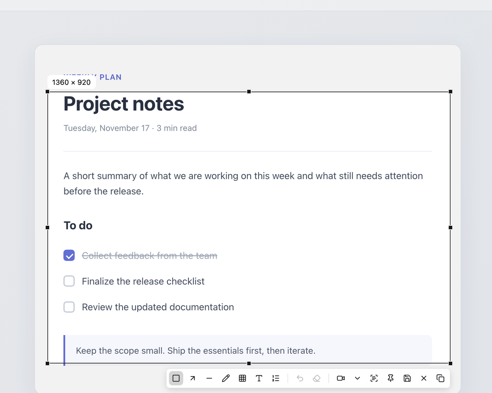
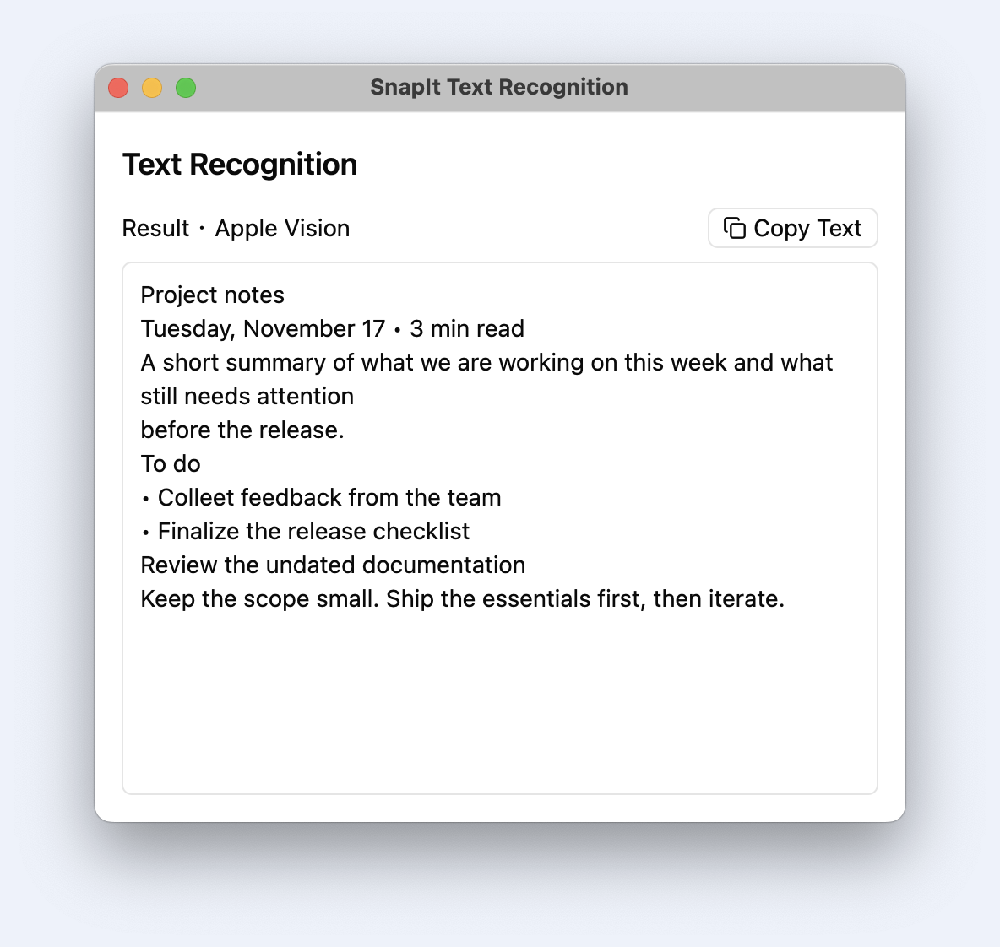
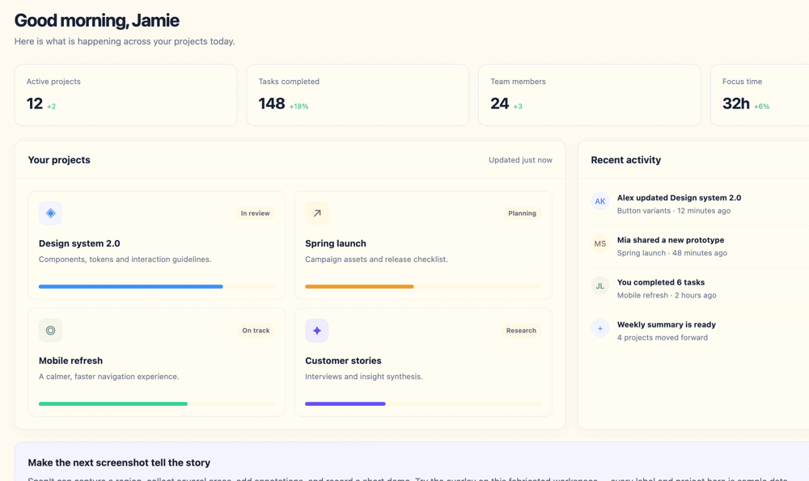
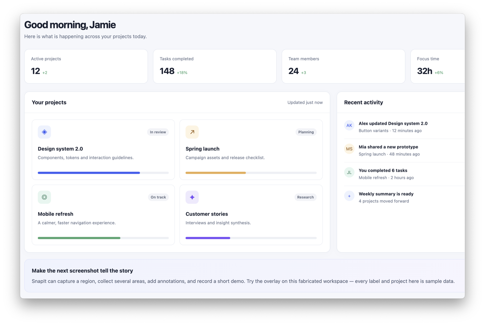
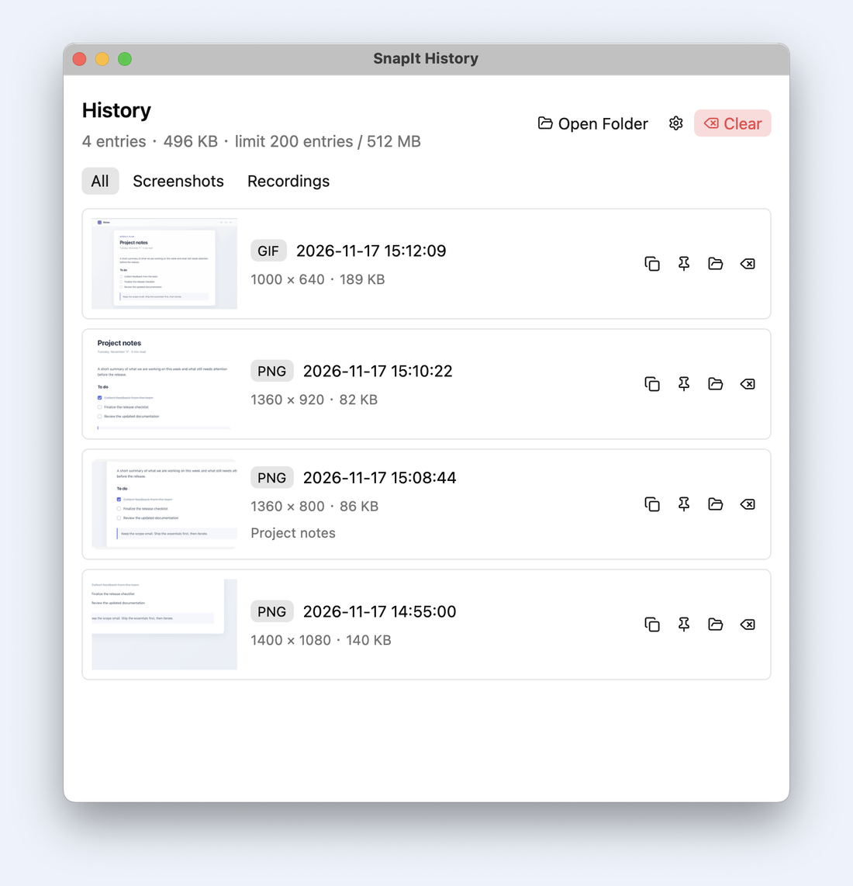
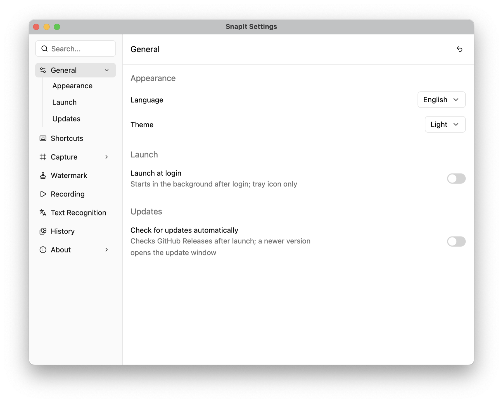

<p align="center">
  
</p>

<h1 align="center">SnapIt</h1>

<p align="center">
  English | <a href="README.md">简体中文</a>
</p>

<p align="center">
  <a href="https://github.com/gjfei/snapit/releases/latest"></a>
</p>

SnapIt is a native screenshot tool for macOS and Windows, written in Rust with [gpui-kit](https://github.com/longbridge/gpui-kit) (Zed's GPUI) — no Electron, no WebView. It lives in the tray with no main window or launcher: a global shortcut freezes every display, and the overlay lets you copy, save, pin, recognize text or record a GIF / MP4 from the selection.

<p align="center">
  
</p>
<p align="center"><sub>Selection overlay and toolbar · all demo data in the previews below is fictional</sub></p>

## Features

- **Multi-monitor region capture**: the whole desktop freezes and each display gets a fullscreen overlay. Drag a region, or hover a window / UI element and click to snap to it.
- **Multiple regions and quick keys**: `F` selects the whole current display, `C` copies the color under the cursor (`#RRGGBB`). Hold `Shift` to collect: click or drag to add regions, click a selected region to remove it. Releasing `Shift` combines same-display regions into one selection that can be annotated; copy / save / pin use the combined image with each region at its original on-screen position and the rest transparent in PNG.
- **Window and element snapping**: highlight the window under the cursor; with element snapping on, the smallest control is highlighted and the wheel moves up through its containers.
- **Annotations**: rectangle, arrow, pen, mosaic, text and numbered steps, with 6 colors and 3 line widths; `⌘Z` / `Ctrl+Z` to undo, plus one-click clear.
- **Copy and save**: copy as PNG; save as PNG or JPEG (with adjustable JPG quality), or change the extension in the save dialog.
- **HDR capture**: when the display is in HDR and the frame actually exceeds SDR white, Save writes a 16-bit PNG tagged with cICP (BT.2020 / PQ). Copy, pins, OCR, GIF and history thumbnails keep the SDR preview, and annotated or multi-region captures stay 8-bit. macOS needs 15+ on Apple Silicon; Windows needs an HDR-enabled display.
- **Pins**: keep a capture on screen, movable, zoomable and translucent; multiple pins are supported.
- **Text recognition**: recognizes the selection and copies the text when it can; the results panel lets you copy again, and the text is stored in history.
- **GIF / MP4 recording**: two separate actions with their own shortcut and tray entry — a GIF drops straight into a chat, an MP4 goes through the system hardware encoder and stays small and smooth. Both show a progress bar with pause / resume, cancel and stop; the shortcut, Stop or the duration limit saves the recording, while `Esc` or Cancel discards it.
- **Tray and global shortcuts**: `⌥⇧A` capture, `⌥⇧O` recognize text, `⌥⇧G` record a GIF, `⌥⇧V` record a video by default. Rebind them in settings; conflicts are reported.
- **History**: copy, save, pin, OCR and recorded GIFs / videos are all saved automatically, pruned by item count (0 keeps everything).
- **Permission guidance**: when macOS screen recording or accessibility access is missing, SnapIt opens a permissions panel that explains what each one is for and links to System Settings.
- **Small and native**: a single executable, light / dark themes that follow the system, Simplified Chinese and English UI.

## How it differs

- **Tray-only**: no main window, launcher or always-open window. Settings, history and OCR results are panels opened on demand.
- **Region-only recording**: GIF / MP4 recording covers the selection; no camera, microphone or picture-in-picture.
- **Element snapping needs a system accessibility API**: available on macOS and Windows.
- **Built-in updater**: checks GitHub Releases after launch (can be disabled in Settings) and on demand from the tray or app menu; downloads, verifies SHA-256, installs and restarts.
- **Windows has an installer**: `setup.exe` installs to `Program Files` with an uninstall entry and is also used for in-app updates; macOS uses DMG / zip.

## Download and install

Download the file for your platform from [GitHub Releases](https://github.com/gjfei/snapit/releases/latest) (`<version>` is the version number):

| Platform | File |
| --- | --- |
| macOS Apple silicon | `SnapIt-<version>-macos-aarch64.dmg` or `.zip` |
| macOS Intel | `SnapIt-<version>-macos-x86_64.dmg` or `.zip` |
| Windows x64 | `SnapIt-<version>-windows-x86_64-setup.exe` |
| Windows ARM64 | `SnapIt-<version>-windows-aarch64-setup.exe` |

Each release also includes `SHA256SUMS.txt` with the checksums of all files and an update manifest, `latest.json`. SnapIt checks it after launch, or on demand from the tray menu or Settings → General → Updates; a manual first install on macOS still needs the Gatekeeper step described below.

### macOS

- Requires macOS 13 or later.
- Release builds are ad-hoc signed and not notarized by Apple by default. On first launch, **right-click the app in Applications → Open**; or run:

  ```sh
  xattr -dr com.apple.quarantine "/Applications/SnapIt.app"
  ```

- **Move the app to Applications before running it**, otherwise Screen Recording permission and notifications attach to the terminal or IDE instead.
- Before the first capture, enable **SnapIt** in **System Settings → Privacy & Security → Screen & System Audio Recording**. Element snapping also needs **Accessibility**. After granting Screen Recording you may need to restart SnapIt.
- When running `cargo run -p snapit` from a terminal or IDE, the permissions belong to that terminal / IDE (Terminal, iTerm, Cursor, …), not to SnapIt.

### Windows

- Run `SnapIt-<version>-windows-<arch>-setup.exe`; it installs to `Program Files\SnapIt` (administrator required), creates a Start Menu shortcut and offers an optional desktop shortcut. The install directory can be changed in the wizard and is reused on the next install.
- In-app updates download and run the newer `setup.exe` silently (administrator permission required); running it manually over the installed version works too. Configuration and history are preserved. If SnapIt is running, interactive setup and the uninstaller ask first; an in-app silent update closes it outright — configuration and history are written immediately.
- The executable is not code-signed, so SmartScreen may warn about an unrecognized app — choose **More info → Run anyway**.
- Capture and element snapping need no extra permission; element snapping uses the Windows accessibility API.
- Uninstall from Settings → Apps → Installed apps → SnapIt, or run `Program Files\SnapIt\uninstall.exe`. Configuration and history are left in place.

## Usage

### Tray and global shortcuts

On launch SnapIt only shows a tray icon (the menu bar on macOS). The tray menu contains Screenshot, Record GIF, Record Video, Recognize Text, Pin Last Capture, History, Settings and Quit. Closing settings, history, OCR results, a pin or the overlay never quits the app. On macOS there is normally no Dock icon; it appears only while the settings, history or OCR panel is open.

Default global shortcuts:

| Action | Default shortcut |
| --- | --- |
| Capture region | `⌥⇧A` (`Alt+Shift+A` on Windows) |
| Recognize text | `⌥⇧O` (`Alt+Shift+O`) |
| Record GIF | `⌥⇧G` (`Alt+Shift+G`) |
| Record video | `⌥⇧V` (`Alt+Shift+V`) |

Rebind them in **Settings → Shortcuts** by clicking and pressing a new combination; `Esc` aborts the rebinding and `Backspace` / `⌫` clears (disables) a binding. Unsupported combinations, conflicts with another action and shortcuts the system refuses to register are reported. While recording, any global shortcut stops the current recording and then runs that shortcut's own action once encoding finishes (press the GIF shortcut again to start the next recording).

Only one SnapIt process runs per data directory, so the tray icon and global hotkeys are never duplicated. A second launch without flags simply exits; `--capture` / `--settings` / `--history` are forwarded to the running instance through `snapit.request` in the data directory and executed there (within about 50 ms) instead of being silently dropped. The login item's `--background` launch has no request and does not open another window.

### Capturing

1. Press the capture shortcut, or choose Screenshot in the tray. Every display freezes immediately and an overlay opens on each monitor.
2. Drag to select a region; after releasing, drag the edges or handles to resize.
3. Press `Enter` or double-click inside the selection to copy, or use a toolbar button. `Esc` or right-click cancels; with a selection active, right-click clears the selection first.
4. `⌘C` / `Ctrl+C` copies, `⌘S` / `Ctrl+S` saves. The clipboard always receives a PNG.
5. `F` selects the whole current display; `C` copies the color under the cursor (`#RRGGBB`, also shown in the magnifier).
6. Hold `Shift` to enter multi-select: click windows / elements or drag to add regions, click a selected region to remove it. Releasing `Shift` combines same-display regions into one selection that can be annotated, copied, saved and pinned: each region keeps its original on-screen position and the rest is transparent in PNG. A combined selection cannot be resized and does not support recording; hold `Shift` again to restore the separate regions for further edits. Regions on different displays are stitched top to bottom and stay separate (no annotations or recording).

<p align="center">
  
</p>
<p align="center"><sub>Hold Shift to collect regions one by one, then release to combine them</sub></p>

The save dialog suggests `SnapIt <date> <time>.<extension>`, and the directory is, in order: the configured save directory → `~/Pictures` → `~/Desktop` → the home directory. Image format and JPG quality live in **Settings → Capture**; changing the extension to `.jpg` / `.jpeg` in the dialog saves as JPEG.

With no selection, hovering highlights the window under the cursor; with element snapping, the smallest control is highlighted, the wheel moves outward to containers and reverses back. Clicking the highlight selects it.

### Annotations

Once a region is selected, annotation tools appear on the left of the toolbar:

| Tool | Notes |
| --- | --- |
| Rectangle | Line width 2 / 4 / 8 px |
| Arrow | Line width 2 / 4 / 8 px |
| Pen | Freehand |
| Mosaic | Real pixelation; no color |
| Text | Click to place, then type; `Enter` confirms, `Esc` cancels |
| Step | Places numbered circles 1, 2, 3… |

<p align="center">
  
</p>
<p align="center"><sub>Rectangle, arrow, pen, mosaic, text and step annotations, with color and line width</sub></p>

Everything except mosaic takes a color; rectangle, arrow and pen also take a line width. Undo and clear buttons sit on the same toolbar, which can be dragged and stays where you drop it. Annotations live on the frozen screenshot: copy, save and pin bake them into the image, while OCR and recording use the unannotated selection.

### Text recognition

Press the OCR shortcut, choose Recognize Text in the tray, or click the recognize button in the overlay toolbar. Recognition starts as soon as the region is committed and opens a small results panel:

- A result is **copied to the clipboard automatically**.
- The panel can copy the text again; no text, a failed recognition or an unavailable backend is reported in the panel.
- Recognition uses the original selection, without annotations.

Choose the language in **Settings → Text Recognition**: automatic (Simplified Chinese, Traditional Chinese, English) or an explicit Simplified Chinese, Traditional Chinese, English, Japanese, Korean, French or German. The setting applies to macOS Vision and Windows.Media.Ocr; the ocrs backend only supports Latin script, so the setting does not change its results.

| Backend | Platform | Notes |
| --- | --- | --- |
| Apple Vision | macOS | Default; no models needed |
| Windows.Media.Ocr | Windows | Default; needs the matching OCR language pack, falls back to ocrs if creation fails |
| [ocrs](https://github.com/robertknight/ocrs) | All | Pure Rust, Latin script only, needs downloaded models |

<p align="center">
  
</p>
<p align="center"><sub>Results panel: a result is copied automatically and can be copied again</sub></p>

### GIF / MP4 recording

1. Press the shortcut for the format you want, choose Record GIF / Record Video in the tray, or click the film / camera button in the overlay toolbar.
2. Recording starts as soon as the region is committed: an outline frames the selection (it sits just outside the captured area, so it never appears in the recording) and a control bar beside it shows the elapsed time and, when set, the duration limit. The bar has three icon-only buttons — pause / resume, cancel and stop (hover for a tooltip); it can be dragged and stays where you drop it. SnapIt's own windows never appear in the recording, so dropping it over the selection is fine.
3. `Space` pauses or resumes: paused frames are not encoded, and the paused stretch is left out of both the file's timeline and the duration limit. Any global shortcut, the bar's stop icon (or `Enter`), or reaching the limit ends and saves the recording; the bar then shows “Encoding GIF…” or “Encoding MP4…”. When a shortcut stopped it, that shortcut's action starts automatically after encoding. `Esc` or the cancel icon discards the recording outright: no file, no history entry, no clipboard write.
4. When encoding finishes, the file is saved automatically to the default save directory as `SnapIt <date> <time>.gif` or `.mp4`, added to history, and a notification shows the path, frame count and duration. The recording is also copied to the clipboard automatically — the GIF as an image, the MP4 as a file — ready to paste right away.

<p align="center">
  
</p>
<p align="center"><sub>The outline sits outside the recorded area; the bar pauses / cancels / stops and can be dragged</sub></p>

<p align="center">
  
</p>
<p align="center"><sub>Recorded GIF (fictional demo content): changes inside the selection captured frame by frame</sub></p>

The format comes from the entry point — the GIF shortcut, tray item and film button write a GIF; the video ones write an MP4 — so there is no default format to pick. Recording options live in **Settings → Recording**: GIF frame rate 1–30 fps (default 12), MP4 frame rate 1–30 fps (default 30), 0–600 seconds (default 0, unlimited), whether to record the mouse pointer (off by default, macOS only). The two containers keep separate frame rates: a palette-based GIF saves more by staying slow, while MP4 goes through a video encoder and can afford a higher rate. Consecutive identical frames are dropped, and output is scaled to the selection's logical width so HiDPI captures stay small.

Each recording writes exactly one file, but GIF and MP4 entries coexist in history. MP4 uses the system's hardware encoder (AVFoundation on macOS, Media Foundation on Windows), so no codec has to be installed; GIF is encoded in pure Rust and plays anywhere. Both stream to disk while recording: on macOS ScreenCaptureKit scales physical-pixel frames down to the selection's logical size during capture (Windows and the fallback path use an integer box mean), and a GIF shares one 256-colour palette trained on a sparse sample (with a lazily built lookup table), encodes only the rectangle that changed and leaves static areas to the previous frame. A scene whose colours drift rebuilds the palette and writes one full frame. That is why stopping takes almost no time and long recordings do not slow down the way per-frame re-quantisation does. H.264 needs even dimensions, so an MP4 can be up to one pixel narrower or shorter than the selection.

### Pins

Click Pin in the overlay toolbar, choose Pin Last Capture in the tray, or pick Pin to Screen in history. If this session has no capture yet, Pin Last Capture uses the newest image in history.

<p align="center">
  
</p>
<p align="center"><sub>Pins stay on top, can be moved, zoomed and made translucent, several at once</sub></p>

- Drag a pin to move it; scroll to zoom; hold `⌥` / `Alt` while scrolling to change opacity (minimum 20%).
- Double-click or `Esc` closes it. The right-click menu copies, saves, sets opacity (100% / 80% / 60% / 40%), zooms, resets zoom or closes.
- `⌘C` / `Ctrl+C` copies, `⌘S` / `Ctrl+S` saves, `⌘=` / `⌘-` / `⌘0` (`Ctrl+=` etc. on Windows) zoom, `⌘W` / `Ctrl+W` closes.
- Pins stay on top and show no Dock icon. A pin from a selection covers that selection's position; one opened from history is scaled to at most 60% of the display and centered.

### History

Copying, saving, pinning, OCR and recording all store a copy in history (disable this in **Settings → History**). By default history keeps at most 200 entries, removing the oldest first; set **Max entries** to 0 to keep everything.

<p align="center">
  
</p>
<p align="center"><sub>History panel with filters, thumbnails and per-entry actions</sub></p>

The history panel has **All / Screenshots / Recordings** filters at the top; the entry count and disk usage update with the selection. It can copy an image, pin it to the screen, reveal it in the file manager, delete an entry, or clear everything. **Click a row's thumbnail or text** to open the **original file** with the system's default app — an image viewer for PNG, a viewer for GIF, a player for MP4. There is no in-app preview. Videos have no Copy Image button but do have **Copy File**, which puts the video file itself on the clipboard, ready to paste into Finder or a chat window. GIF and MP4 entries use a first-frame PNG thumbnail in the list and when pinned.

### Settings

| Page | Options |
| --- | --- |
| General | Language (follow system / Simplified Chinese / English), theme (follow system / light / dark), launch at login |
| Shortcuts | Global shortcuts for capture, text recognition, GIF and video recording |
| Capture | Default save directory, image format (PNG / JPEG), JPG quality, window snapping, element snapping, dim mask strength, selection drop shadow |
| Recording | Frame rate, maximum duration, cursor |
| Text Recognition | Recognition language |
| History | Enable saving, maximum entries (0 = unlimited), and a button to open the history panel |
| About | Config file path and Reveal in Folder |

<p align="center">
  
</p>
<p align="center"><sub>Settings: General, Shortcuts, Capture, Recording, Text Recognition, History and About</sub></p>

Launch at login is registered through a LaunchAgent (macOS) or the current user's registry Run key (Windows). It passes `--background`, so the app starts in the tray.

## Keyboard shortcuts

Global shortcuts are listed above and can be changed in settings. The following work while the relevant window has focus:

| Action | macOS | Windows |
| --- | --- | --- |
| Confirm selection (copy) | <kbd>Enter</kbd> | <kbd>Enter</kbd> |
| Copy | <kbd>⌘C</kbd> | <kbd>Ctrl+C</kbd> |
| Save | <kbd>⌘S</kbd> | <kbd>Ctrl+S</kbd> |
| Select the whole current display | <kbd>F</kbd> | <kbd>F</kbd> |
| Copy the color under the cursor | <kbd>C</kbd> | <kbd>C</kbd> |
| Add a region (multi-select) | <kbd>Shift</kbd> + click / drag | <kbd>Shift</kbd> + click / drag |
| Undo annotation | <kbd>⌘Z</kbd> | <kbd>Ctrl+Z</kbd> |
| Cancel capture / close pin | <kbd>Esc</kbd> | <kbd>Esc</kbd> |
| Pause / resume while recording | <kbd>Space</kbd> | <kbd>Space</kbd> |
| Stop and save while recording | <kbd>Enter</kbd> | <kbd>Enter</kbd> |
| Discard while recording | <kbd>Esc</kbd> | <kbd>Esc</kbd> |
| Close pin | <kbd>⌘W</kbd> | <kbd>Ctrl+W</kbd> |
| Pin zoom in / out / reset | <kbd>⌘=</kbd> / <kbd>⌘-</kbd> / <kbd>⌘0</kbd> | <kbd>Ctrl+=</kbd> / <kbd>Ctrl+-</kbd> / <kbd>Ctrl+0</kbd> |
| Open settings | <kbd>⌘,</kbd> | <kbd>Ctrl+,</kbd> |
| Open history | <kbd>⌘Y</kbd> | <kbd>Ctrl+Y</kbd> |
| Quit | <kbd>⌘Q</kbd> | <kbd>Ctrl+Q</kbd> |

## Permissions

- **macOS**: capturing and recording need **Screen Recording**; element snapping needs **Accessibility**. If something is missing at launch, SnapIt opens the permissions panel, which links to the relevant System Settings pane and can re-check. Screen Recording is required; Accessibility can be skipped, in which case hovering only selects whole windows. You may need to restart the app after granting Screen Recording.
- **Windows**: no extra permissions. Element snapping uses the system accessibility API; SmartScreen may block the first launch (see “Download and install”).

The permissions panel only exists on macOS. A `--background` login launch does not show it; it appears when you start a capture.

## Config and data locations

Paths come from `directories::ProjectDirs::from("dev", "SnapIt", "SnapIt")`. Setting `SNAPIT_HOME` puts config and data under one directory.

| File | macOS | Windows |
| --- | --- | --- |
| Settings `config.toml` | `~/Library/Application Support/dev.SnapIt.SnapIt/config.toml` | `%APPDATA%\SnapIt\SnapIt\config\config.toml` |
| History `history/index.json`, captures and recordings | `~/Library/Application Support/dev.SnapIt.SnapIt/history/` | `%APPDATA%\SnapIt\SnapIt\data\history\` |

The default TOML is written on first run. A corrupt config is moved to `config.toml.bak` and replaced with defaults. Settings are written back to `config.toml` as soon as they change.

## Building from source

### Prerequisites

- Install [rustup](https://rustup.rs/). The toolchain is pinned in `rust-toolchain.toml` (currently 1.99.1) and is downloaded on the first build.
- This repository pulls `vendor/xcap` in as a git submodule (it carries the recording needs: region crop, frame-rate cap, timestamps, cursor options and the `OutputSize::Logical` hint). Clone with `git clone --recursive`; an existing clone needs `git submodule update --init`.
- **macOS**: Xcode Command Line Tools (`xcode-select --install`).
- **Windows**: install the “Desktop development with C++” workload in Visual Studio Build Tools, including MSVC and the Windows SDK (gpui compiles shaders with the SDK's `fxc`, and the packaging script uses the resource compiler to embed the icon). Building the installer also needs [NSIS](https://nsis.sourceforge.io/) (`makensis`).

### Commands

```bash
cargo check --workspace --all-targets   # type check
cargo build                             # build snapit
cargo test --workspace                  # run tests
cargo clippy --workspace --all-targets -- -D warnings   # lints; must stay warning-free
cargo run -p snapit                      # tray + global shortcuts only
cargo run -p snapit -- --capture         # start and capture immediately
cargo run -p snapit -- --settings        # open the settings window
cargo run -p snapit -- --history         # open the history window
cargo run -p snapit -- --background      # login launch (same tray-only mode)
```

Each crate also ships a command-line example:

```bash
cargo run -p snapit-capture  --example capture_once -- /tmp
cargo run -p snapit-ocr      --example ocr_image    -- path/to/image.png
cargo run -p snapit-recorder --example record_gif   -- /tmp/out.gif 3
cargo run -p snapit-recorder --example record_video -- /tmp/out.mp4 3 1280
```

### Architecture

```
crates/
├── capture   # snapit-capture: xcap multi-monitor capture, scale conversion, crop, encoding, windows/elements
├── recorder  # snapit-recorder: xcap capture + gif / system H.264 encoding, duplicate-frame dedupe, duration cap
├── ocr       # snapit-ocr: OcrEngine trait + Vision / ocrs / Windows.Media.Ocr backends
├── store     # snapit-store: TOML settings, history index and pruning, app directories
└── app       # snapit: gpui-kit UI, tray, global shortcuts, selection overlays, annotations, pins, recording bar
```

Main modules in `crates/app`: `controller.rs` (the global workflow), `session.rs` (frozen frames and selection), `overlay.rs` (selection UI and toolbar), `annotate.rs` (annotation model and baking), `pin.rs`, `recording_bar.rs`, `tray.rs`, `settings*`, `history*`, `hotkey.rs`, `permissions*`, `appearance.rs` and `autostart.rs`.

## macOS app bundle

`cargo run -p snapit` runs the bare `snapit` binary, so Screen Recording permission and notifications attach to Terminal / Cursor. A local bundle attaches them to **SnapIt.app** (bundle id `dev.SnapIt.SnapIt`, matching the config directory):

```bash
./scripts/bundle-macos.sh
# Uses an existing debug binary; builds with cargo build -p snapit only if needed
# Output: target/macos/SnapIt.app
# Custom binary: ./scripts/bundle-macos.sh --bin /path/to/snapit
```

1. Open `target/macos/SnapIt.app` (do not verify a bundle with `cargo run`).
2. Enable **SnapIt** in **System Settings → Privacy & Security → Screen & System Audio Recording**.
3. Notifications also belong to SnapIt.app; they are unavailable when the binary is not in an `.app`.

The script ad-hoc signs with `codesign --sign - --force --deep`; no paid certificate is required. Rebuilding changes the signature, so macOS may treat it as a new app and Screen Recording must be granted again.

## Packaging

The entry point is `./scripts/bundle.sh macos|windows|all`. If the Rust target, cross linker or NSIS is missing, Windows prints `skip:` and exits 0; the scripts **never** install cross toolchains.

```bash
./scripts/bundle.sh macos
./scripts/bundle.sh windows
./scripts/bundle.sh all
```

| Platform | Script | Output |
| --- | --- | --- |
| macOS | `scripts/bundle-macos.sh` | `target/macos/SnapIt.app` (CI passes `--target` and writes `dist/SnapIt.app`) |
| macOS installer | `scripts/package-macos.sh` | `dist/SnapIt-<version>-macos-aarch64.dmg` and `.zip` (Intel: `macos-x86_64`) |
| Windows | `scripts/bundle-windows.sh` | `dist/SnapIt-<version>-windows-x86_64-setup.exe` (ARM64: `windows-aarch64`); the `dist/windows/SnapIt/` staging directory holds `SnapIt.exe` |

The Windows installer is compiled with NSIS (`scripts/windows/snapit.nsi`) and installs to `Program Files\SnapIt` for all users. Set `MAKENSIS=/path/to/makensis` when it is not on `PATH`. Without `--target`, Windows builds with the rustc host triple (MSVC or GNU); other hosts cross-compile `x86_64-pc-windows-msvc` by default.

`dist/` is gitignored. Building a Windows (`x86_64-pc-windows-msvc`) package on macOS requires both the Rust target **and** a linker (for example `cargo-xwin`); without them the script skips.

The macOS DMG wraps the `.app` with `hdiutil` as a ULMO (lzma) image containing an Applications shortcut, plus a `ditto` zip (no create-dmg):

```bash
./scripts/bundle-macos.sh --release
./scripts/package-macos.sh
# Output: dist/SnapIt-<version>-macos-aarch64.dmg and .zip
# Intel: ./scripts/package-macos.sh --target x86_64-apple-darwin
```

Signing / notarization / stapling use the same environment variables (and GitHub Secrets names) as SwitchHostsLite: `MACOS_CERTIFICATE`, `MACOS_CERTIFICATE_PASSWORD`, `MACOS_SIGNING_IDENTITY`, `APPLE_ID`, `APPLE_TEAM_ID`, `APPLE_APP_PASSWORD`. Without them the app stays ad-hoc signed and the DMG is still produced — this is **not** a failure.

## Releasing

Bump `[workspace.package] version` in `Cargo.toml`, commit, then push a **`vX.Y.Z`** tag that matches it (for example `0.1.0` → `v0.1.0`):

```bash
git tag v0.1.0
git push origin v0.1.0
```

[`.github/workflows/release.yml`](.github/workflows/release.yml) first checks the tag against the `Cargo.toml` version, then builds four targets:

- macOS arm64 and macOS Intel (`macos-latest`, cross-compiled, deployment target 13.0)
- Windows x64 and Windows ARM64 (`windows-latest`, cross-compiled)

Uploaded files:

| Platform | File |
| --- | --- |
| macOS Apple silicon | `SnapIt-<version>-macos-aarch64.dmg` or `.zip` |
| macOS Intel | `SnapIt-<version>-macos-x86_64.dmg` or `.zip` |
| Windows x64 | `SnapIt-<version>-windows-x86_64-setup.exe` |
| Windows ARM64 | `SnapIt-<version>-windows-aarch64-setup.exe` |

The release job also generates `SHA256SUMS.txt` and the `latest.json` update manifest (`scripts/release-manifest.py`), then creates a GitHub Release with automatically generated notes. Tags containing `-` (for example `v0.2.0-beta.1`) become pre-releases. You can also run `workflow_dispatch` for an **existing** tag from the Actions page; do not release from an untagged branch.

`.github/workflows/ci.yml` runs `cargo test --locked` and clippy on macOS and Windows. CI uses the 1.99.1 pin from `rust-toolchain.toml`; **do not change it to `stable`**.

### Optional code signing

`release.yml` contains a commented-out Windows signing step; enable it after configuring `WINDOWS_CERTIFICATE` and `WINDOWS_CERTIFICATE_PASSWORD` to produce an Authenticode-signed executable. macOS signing / notarization activates automatically once the Apple secrets above are present. Missing signing configuration never fails the release.

## OCR models (ocrs backend)

macOS uses Vision and Windows uses Windows.Media.Ocr by default, so neither needs models. When WinRT creation fails, Windows falls back to ocrs, which needs two model files (not committed to the repository):

```bash
mkdir -p ~/.snapit/models && cd ~/.snapit/models
curl -LO https://ocrs-models.s3-accelerate.amazonaws.com/text-detection.rten
curl -LO https://ocrs-models.s3-accelerate.amazonaws.com/text-recognition.rten
```

Model lookup order: the `SNAPIT_OCR_MODELS` environment variable → `models/` next to the executable → `~/.snapit/models`.

## Known limitations

- **Element snapping** works only on macOS and Windows, and only with Accessibility permission; it also requires window snapping to be enabled.
- **Recording** (GIF / MP4) covers the selection only and has no audio; the default limit is 0 (unlimited) and the maximum is 600 seconds. Recording entries in history use a first-frame PNG thumbnail and are pinned as that still image; videos open in the system player rather than inside the app.
- **Recording bar and cursor**: SnapIt's own windows (the selection outline and the bar) are always left out of the recording — through ScreenCaptureKit on macOS and display affinity on Windows — so the bar can sit anywhere. DXGI never includes the pointer, so recording the cursor is macOS-only.
- **Copying a video file**: macOS writes a file reference (pasteable); Windows falls back to copying the path as text.
- **OCR**: the ocrs backend is Latin-only; the language setting only affects Vision and Windows.Media.Ocr.
- **Auto-updates**: macOS builds are ad-hoc signed by default and the updater replaces the `.app` in `/Applications`; a development build run from `target/debug` cannot update itself. Windows updates run `setup.exe` elevated.
- **One selection at a time**: all displays freeze together, but a selection always lives on a single display.

## Credits and license

- The UI is built on [gpui](https://www.gpui.rs/) and [gpui-kit](https://github.com/longbridge/gpui-kit) (pinned to `0.9.1`, which tracks GPUI `gpui-pre` 0.3.12), both Apache-2.0.
- Capture uses [xcap](https://github.com/nashaofu/xcap); recording uses the [SnapIt fork](https://github.com/gjfei/xcap) pulled in as a submodule (ScreenCaptureKit on macOS, plus region capture, frame-rate cap, timestamps, cursor, own-window exclusion and an `OutputSize::Logical` hint). GIF encoding uses [gif](https://github.com/image-rs/image-gif) with [color_quant](https://crates.io/crates/color_quant) for a shared palette, table-driven quantization and dirty-rectangle frames; macOS scales in the compositor when the logical-size hint is set and keeps an integer box mean as the fallback rather than a general resize filter. MP4 goes through the system hardware encoder on macOS and Windows (AVFoundation / Media Foundation).
- Pure-Rust OCR uses [ocrs](https://github.com/robertknight/ocrs).
- Annotation baking uses [tiny-skia](https://github.com/RazrFalcon/tiny-skia); text bitmaps use [fontdue](https://github.com/mooman219/fontdue).
- The tray, global shortcuts and launch at login use [tray-icon](https://github.com/tauri-apps/tray-icon), [global-hotkey](https://github.com/tauri-apps/global-hotkey) and [auto-launch](https://github.com/zzzgydi/auto-launch).
- UI icons come from [Lucide](https://lucide.dev/) (ISC); the app icon and menu bar template live in `assets/`.

SnapIt is released under the [Apache-2.0 license](LICENSE).
