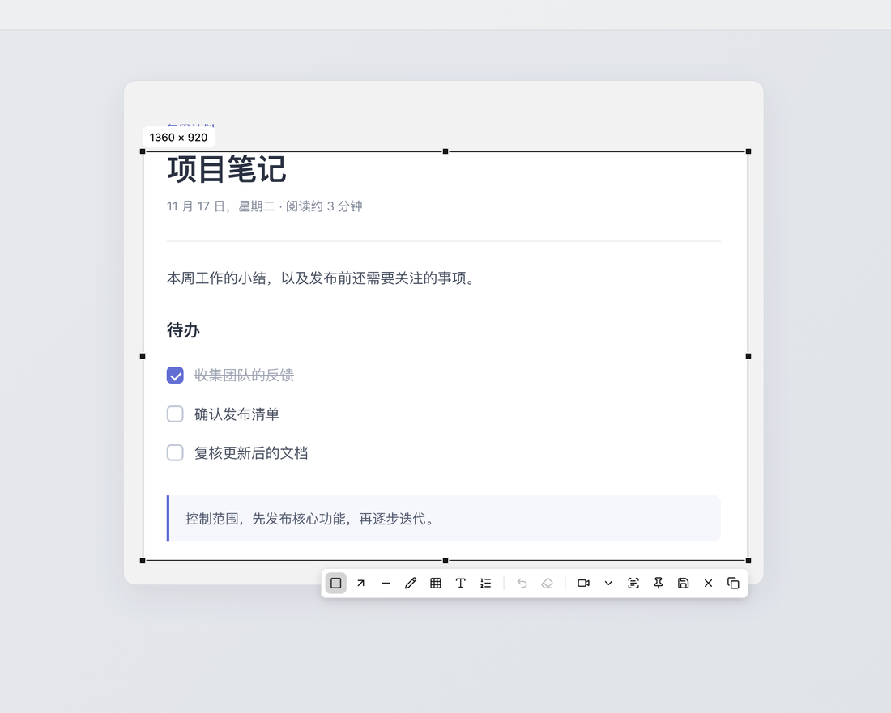
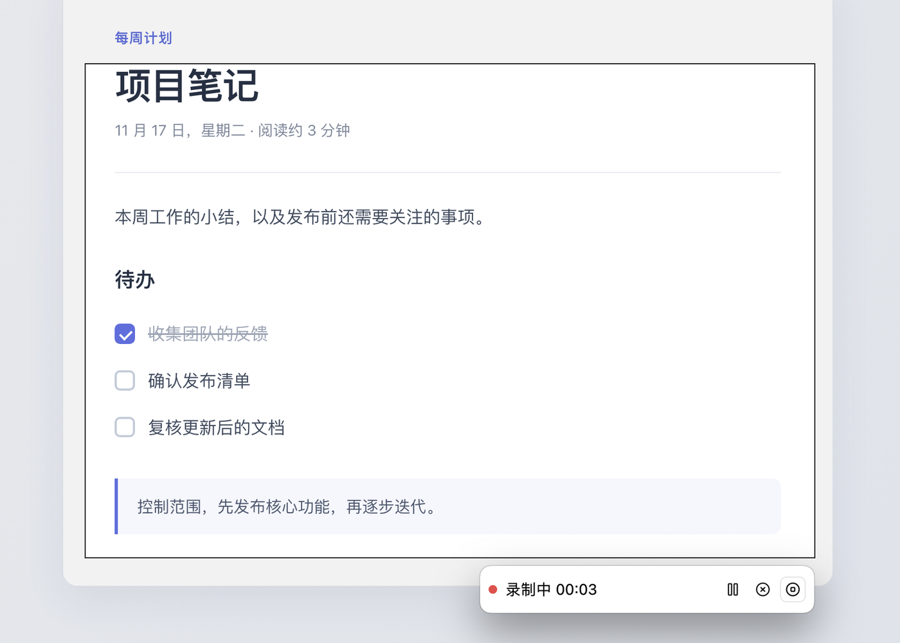
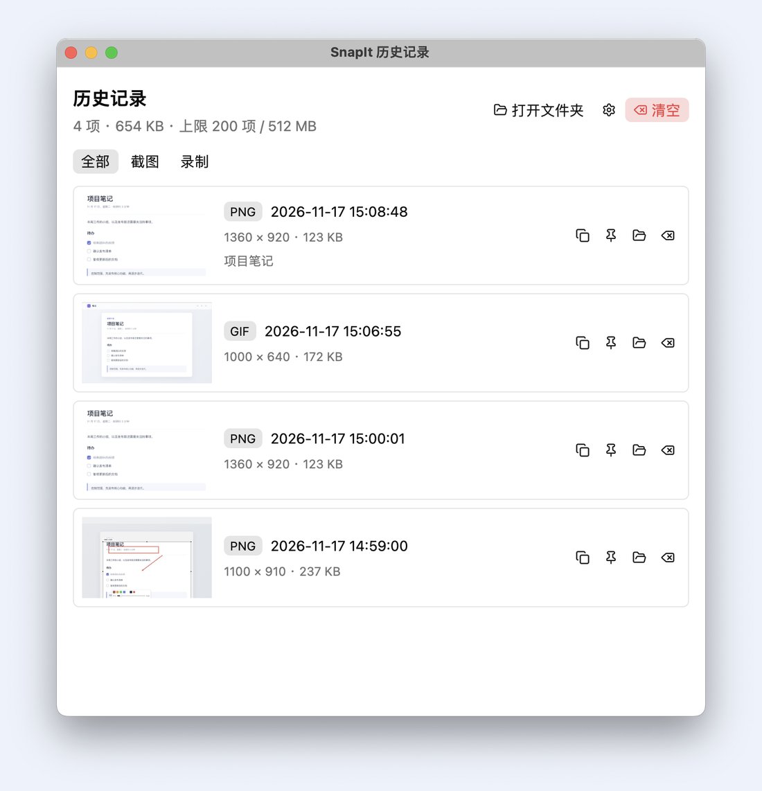
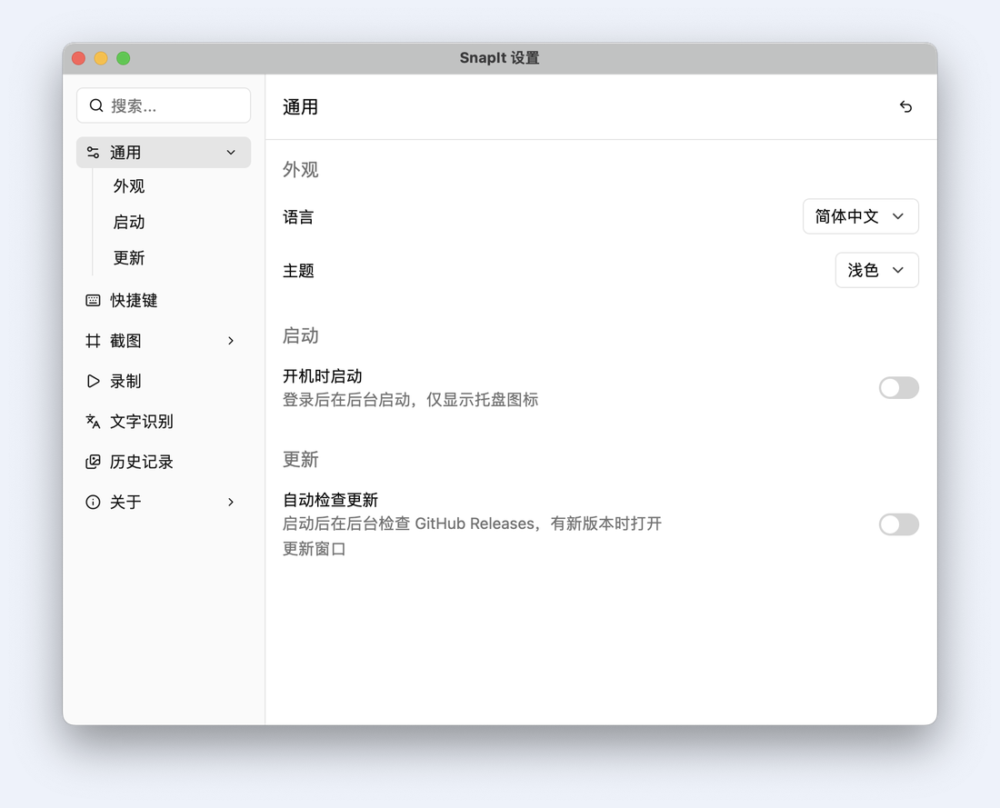

<p align="center">
  
</p>

<h1 align="center">SnapIt</h1>

<p align="center">
  简体中文 | <a href="README.en.md">English</a>
</p>

<p align="center">
  <a href="https://github.com/gjfei/snapit/releases/latest"></a>
</p>

SnapIt 是支持 macOS 和 Windows 的原生截图工具，用 Rust 和 [gpui-kit](https://github.com/longbridge/gpui-kit)（Zed GPUI）写成，不依赖 Electron 或 WebView。它常驻托盘，没有主窗口或启动器：按下全局快捷键后冻结所有显示器，在选区上完成复制、保存、贴图、文字识别或录制 GIF / MP4。

<p align="center">
  
</p>
<p align="center"><sub>选区浮层与工具栏 · 以下界面预览中的演示数据均为虚构内容</sub></p>

## 功能

- **多显示器区域截图**：截图时冻结全部显示器，每个显示器一个全屏浮层；拖拽选区，或把光标悬停在窗口 / 界面元素上单击选择。
- **多选区与快捷操作**：`F` 选中当前显示器全屏，`C` 复制光标处的颜色（`#RRGGBB`）。按住 `Shift` 进入多选：单击或拖动逐个添加选区，单击已选区域可移除；松开 `Shift` 后同一显示器的选区合成一个整体选区，可继续标注，复制 / 保存 / 贴图使用合成图，各区域保持屏幕上的原始位置，其余部分在 PNG 中透明。
- **自动框选窗口与元素**：高亮光标下的窗口；开启元素框选后会进一步高亮最小的界面控件，滚轮可在控件与上层容器之间切换层级。
- **标注**：矩形、箭头、画笔、马赛克、文字、序号，6 种颜色、3 档线宽；`⌘Z` / `Ctrl+Z` 撤销，可一键清除。
- **复制与保存**：复制为 PNG；另存为 PNG 或 JPEG（可调 JPG 质量），也可在保存对话框里改扩展名。
- **贴图（Pin）**：把截图钉在屏幕上，可拖动、缩放、调整透明度，支持多张贴图。
- **文字识别**：识别选区文字并尽量自动复制；结果面板可再次复制，识别文字也会写入历史记录。
- **录制 GIF / MP4**：录制是两件独立的事，各有自己的快捷键和托盘菜单项——GIF 适合贴进聊天窗口，MP4 走系统硬件编码、体积更小也更流畅。录制时显示进度控制条，可暂停 / 继续、取消或停止；按快捷键、点「停止」或到达时长上限会结束并保存，按 `Esc` 或点「取消」则丢弃本次录制。
- **托盘与全局快捷键**：默认 `⌥⇧A` 截图、`⌥⇧O` 识别文字、`⌥⇧G` 录制 GIF、`⌥⇧V` 录制视频，可在设置中修改，冲突会提示。
- **历史记录**：复制、保存、贴图、识别文字和录制的 GIF / 视频都会自动保存一份，按条数和占用空间自动清理。
- **权限引导**：macOS 上缺少屏幕录制 / 辅助功能权限时（启动或开始截图时）会打开权限面板，说明用途并跳到系统设置。
- **轻量原生**：单个可执行文件，界面跟随系统浅色 / 深色主题，支持简体中文和 English。

## 与常见截图工具的差异

- **只做托盘应用**：没有主窗口、启动器和常驻大窗口，设置、历史、识别结果都是按需打开的面板。
- **只录选区**：录制（GIF / MP4）只支持选区，没有摄像头、麦克风和画中画。
- **元素框选依赖系统辅助功能 API**：macOS 与 Windows 均可用。
- **内置更新器**：启动后自动检查 GitHub Releases（可在设置中关闭），托盘「检查更新…」或应用菜单可手动检查；下载后校验 SHA-256，安装并自动重启。
- **Windows 提供安装程序**：`setup.exe` 安装到 `Program Files`，自带卸载项，应用内更新会静默调用它；macOS 使用 DMG / zip。

## 下载安装

从 [GitHub Releases](https://github.com/gjfei/snapit/releases/latest) 下载对应平台的文件（`<版本>` 为版本号）：

| 平台 | 文件 |
| --- | --- |
| macOS Apple 芯片 | `SnapIt-<版本>-macos-aarch64.dmg` 或 `.zip` |
| macOS Intel | `SnapIt-<版本>-macos-x86_64.dmg` 或 `.zip` |
| Windows x64 | `SnapIt-<版本>-windows-x86_64-setup.exe` |
| Windows ARM64 | `SnapIt-<版本>-windows-aarch64-setup.exe` |

每个版本还附带 `SHA256SUMS.txt`（所有文件的校验和）和更新清单 `latest.json`。应用会在启动后检查它，也可以在托盘菜单或设置 → 通用 → 更新中手动检查；macOS 首次手动覆盖安装仍需按下方 macOS 说明绕过 Gatekeeper。

### macOS

- 要求 macOS 13 或更高版本。
- 安装包默认只做 ad-hoc 签名，没有经过 Apple 公证。第一次打开时请在「应用程序」中**右键点击应用 → 打开**；或者执行：

  ```sh
  xattr -dr com.apple.quarantine "/Applications/SnapIt.app"
  ```

- 请先把应用**移动到「应用程序」文件夹**再运行，否则屏幕录制权限和通知会记在终端或 IDE 上。
- 首次截图前需要在 **系统设置 → 隐私与安全性 → 屏幕与系统音频录制** 中勾选 **SnapIt**；要使用元素框选，还需要在 **辅助功能** 中勾选。授权屏幕录制后可能需要重新启动 SnapIt。
- 从终端或 IDE 里 `cargo run -p snapit` 时，权限属于对应的终端 / IDE（Terminal、iTerm、Cursor 等），而不是 SnapIt。

### Windows

- 运行 `SnapIt-<版本>-windows-<arch>-setup.exe`，安装到 `Program Files\SnapIt`（需要管理员权限），默认创建开始菜单快捷方式，可选桌面快捷方式。安装目录可在向导中修改，下次安装会沿用上次的目录。
- 应用内更新会自动下载并运行新版本的 `setup.exe`（静默安装，需要管理员权限）；也可以手动运行它覆盖安装。配置和历史记录会保留。若 SnapIt 正在运行，交互安装 / 卸载会先询问；应用内静默更新则直接结束进程再继续——配置和历史都是即时写入的。
- 程序没有代码签名，SmartScreen 可能提示「Windows 已保护你的电脑」，点击「更多信息 → 仍要运行」即可。
- 截图与元素框选不需要额外系统权限；元素框选使用 Windows 辅助功能 API。
- 卸载：设置 → 应用 → 已安装的应用 → SnapIt，或运行 `Program Files\SnapIt\uninstall.exe`。卸载会保留配置和历史记录。

## 使用说明

### 托盘与全局快捷键

启动后只在托盘（macOS 菜单栏）显示图标，托盘菜单依次是：截图、录制 GIF、录制视频、识别文字、钉住上次截图、历史记录、设置、退出。关闭设置 / 历史 / 识别结果 / 贴图 / 截图浮层都不会退出应用。macOS 上平时不显示 Dock 图标，打开设置、历史或识别结果面板时才会临时显示。

默认全局快捷键：

| 操作 | 默认快捷键 |
| --- | --- |
| 区域截图 | `⌥⇧A`（Windows：`Alt+Shift+A`） |
| 识别文字 | `⌥⇧O`（`Alt+Shift+O`） |
| 录制 GIF | `⌥⇧G`（`Alt+Shift+G`） |
| 录制视频 | `⌥⇧V`（`Alt+Shift+V`） |

可在 **设置 → 快捷键** 中点击后按下新组合键；`Esc` 放弃录入，`Backspace` / `⌫` 清除（禁用）。不支持的组合、与其他动作冲突或被其他应用占用时会显示错误。录制期间按任一全局快捷键会停止当前录制，并在编码完成后执行该快捷键对应的动作（例如再按一次 GIF 快捷键即可接着录下一段）。

同一数据目录只允许运行一个 SnapIt，避免重复托盘图标和全局快捷键冲突。再次启动时若不带参数会直接退出；带 `--capture` / `--settings` / `--history` 时，请求会通过数据目录里的 `snapit.request` 转交给已运行的实例执行（约 50 ms 内响应），不会静默丢失。开机自启的 `--background` 属于无参数启动，不会重复打开窗口。

### 截图

1. 按下截图快捷键，或从托盘选择「截图」。所有显示器会立即冻结，并在每个显示器上打开一个浮层。
2. 拖动鼠标选择区域；松开后可拖动边缘调整大小。
3. 用 `Enter` 或双击选区复制，或点击工具栏上的按钮。`Esc` 或右键取消；已有选区时右键先清除选区。
4. `⌘C` / `Ctrl+C` 复制，`⌘S` / `Ctrl+S` 保存。复制到剪贴板的内容始终是 PNG。
5. `F` 直接选中当前显示器的整个画面；`C` 复制光标下的颜色（`#RRGGBB`，放大镜里也会显示）。
6. 按住 `Shift` 进入多选模式：单击窗口 / 元素或拖动框选可逐个添加，单击已选区域可移除。松开 `Shift` 后同一显示器上的选区会合成一个整体选区，可直接标注、复制、保存、贴图：各区域保持屏幕上的原始位置，其余部分在 PNG 中透明；合成后不能拖边缩放，也不支持录制，再按住 `Shift` 可恢复为多个选区继续增删。跨显示器时改为上下拼接，仍按多个区域处理（不支持标注和录制）。

<p align="center">
  
</p>
<p align="center"><sub>按住 Shift 逐个收集选区，松开后合成一个整体选区</sub></p>

保存对话框默认文件名是 `SnapIt <日期> <时间>.<扩展名>`，默认目录依次为：设置里指定的保存目录 → `~/Pictures` → `~/Desktop` → 用户主目录。图片格式和 JPG 质量在 **设置 → 截图** 中调整；在保存对话框里把扩展名改成 `.jpg` / `.jpeg` 会按 JPEG 保存。

未打开选区时，悬停会高亮光标下的窗口；开元素框选时高亮最小的界面控件，滚轮向外切换容器，反向滚动再收回。单击高亮区域直接选中它。

### 标注

选中区域后，工具栏左侧出现标注工具：

| 工具 | 说明 |
| --- | --- |
| 矩形 | 线宽 2 / 4 / 8 px |
| 箭头 | 线宽 2 / 4 / 8 px |
| 画笔 | 自由绘制 |
| 马赛克 | 真实像素化，不跟随颜色 |
| 文字 | 点击定位后输入，`Enter` 确认、`Esc` 取消 |
| 序号 | 依次放置 1、2、3… 的圆形编号 |

<p align="center">
  
</p>
<p align="center"><sub>矩形、箭头、画笔、马赛克、文字与序号标注，可选颜色和线宽</sub></p>

除马赛克外都可以选颜色；矩形、箭头、画笔可选线宽。工具栏上还有撤销和清除标注。工具栏可以拖动，拖到想放的位置后就停在那里。标注只画在冻结的截图上：复制、保存和贴图时会把标注烘焙进图片；文字识别和录制使用未标注的选区。

### 文字识别

按识别快捷键、从托盘选择「识别文字」，或在选区工具栏点击识别按钮。拖动选区后立刻开始识别，并打开小结果面板：

- 有识别结果时会**自动复制**到剪贴板。
- 结果面板可再次复制文字；没有文字、识别失败或后端不可用时会显示对应提示。
- 识别使用当前选区的原始画面（不含标注）。

识别语言在 **设置 → 文字识别** 中选择：自动（简体中文、繁体中文、英文）或指定的简体中文、繁体中文、英文、日文、韩文、法文、德文。语言设置对 macOS Vision 和 Windows.Media.Ocr 生效；ocrs 后端只支持拉丁字母，此设置不改变结果。

| 后端 | 平台 | 说明 |
| --- | --- | --- |
| Apple Vision | macOS | 默认，无需模型 |
| Windows.Media.Ocr | Windows | 默认，需要系统安装对应 OCR 语言包；创建失败时回退到 ocrs |
| [ocrs](https://github.com/robertknight/ocrs) | 回退后端 | 纯 Rust，仅拉丁字母，需要下载模型 |

<p align="center">
  
</p>
<p align="center"><sub>识别结果面板：有结果时自动复制到剪贴板，可再次复制</sub></p>

### 录制 GIF / MP4

1. 按对应快捷键、从托盘选择「录制 GIF」/「录制视频」，或在选区工具栏点击胶片 / 摄像机按钮。
2. 拖动选区后立即开始录制：选区四周出现高亮边框（边框落在录制区域之外，不会录进画面），旁边出现控制条，显示已录制时间；设置了时长上限时还会显示上限。控制条上是暂停 / 继续、取消、停止三个图标按钮（鼠标悬停会显示用途），可以拖动，拖到哪就停在哪儿；SnapIt 自己的窗口不会出现在录制画面里，所以拖到选区上也没关系。
3. 按 `Space` 暂停或继续：暂停期间画面不会被写入文件，暂停的时间也不计入录制时长和时长上限，继续后时间轴接着走。按任一全局快捷键、点击停止图标（或按 `Enter`），或到达最长时长都会结束并保存录制；随后控制条显示「正在生成 GIF…」或「正在生成 MP4…」。用快捷键停止时，该快捷键对应的动作会在编码完成后自动开始。按 `Esc` 或点取消图标则直接丢弃本次录制：不生成文件、不进历史记录、不写剪贴板。
4. 编码完成后文件自动保存到默认保存目录，文件名为 `SnapIt <日期> <时间>.gif` 或 `.mp4`，同时写入历史记录；通知里显示路径、帧数和时长。GIF 会以图片形式、MP4 会以文件形式自动复制到剪贴板，结束后直接粘贴即可。

<p align="center">
  
</p>
<p align="center"><sub>录制边框落在选区之外，控制条可暂停 / 取消 / 停止并可拖动</sub></p>

<p align="center">
  
</p>
<p align="center"><sub>GIF 录制效果（演示画面为虚构内容）：逐帧记录选区内的变化</sub></p>

格式由入口决定：GIF 入口（快捷键、托盘菜单、胶片按钮）写 GIF，视频入口写 MP4，不需要再选「默认格式」。录制参数在 **设置 → 录制** 中调整：帧率 1–30 fps（默认 12）、最长时长 0–600 秒（默认 0，即不限时长）和是否录制鼠标光标（默认关闭，仅 macOS）。录制时会去掉连续相同的帧，并按选区的逻辑宽度输出，避免 HiDPI 下文件过大。

一次录制只产出一个文件，但两种格式的录制都会留在历史记录里并存。MP4 走系统硬件编码（macOS 用 AVFoundation，Windows 用 Media Foundation），不需要另外安装编码器；GIF 用纯 Rust 编码，任何地方都能直接播放。两者都是边录边写：macOS 上由 ScreenCaptureKit 在采集阶段直接把 HiDPI 物理像素帧缩到选区的逻辑尺寸，Windows 与回落路径再做一次整数均值降采样；GIF 整段复用同一张 256 色板（从画面抽样训练、按需建立查表），并且只编码画面里变化的矩形，静止区域沿用上一帧内容，画面配色变化较大时会自动重建色板并写一帧全画面。所以停止后几乎不用等待，也不会像逐帧重新量化那样越录越慢。H.264 要求偶数宽高，所以 MP4 的尺寸最多比选区少 1 像素。

### 贴图

在选区工具栏点击「钉住」、从托盘选择「钉住上次截图」，或在历史记录里选择「钉在屏幕上」。没有本次会话的截图时，「钉住上次截图」会使用历史记录里最新的一张图片。

<p align="center">
  
</p>
<p align="center"><sub>贴图始终置顶，可拖动、缩放并调整透明度，支持多张</sub></p>

- 拖动贴图移动；滚轮缩放；按住 `⌥` / `Alt` 滚动调整不透明度（最低 20%）。
- 双击或 `Esc` 关闭；右键菜单可复制、保存、调整不透明度（100% / 80% / 60% / 40%）、缩放、恢复原始大小、关闭。
- `⌘C` / `Ctrl+C` 复制，`⌘S` / `Ctrl+S` 保存，`⌘=` / `⌘-` / `⌘0`（Windows：`Ctrl+=` 等）缩放，`⌘W` / `Ctrl+W` 关闭。
- 贴图始终置顶，不显示 Dock 图标；从选区打开时覆盖在原选区位置，从历史记录打开时缩放到不超过屏幕的 60% 并居中。

### 历史记录

复制、保存、贴图、识别文字和录制时都会自动保存一份到历史记录（可在 **设置 → 历史记录** 关闭）。默认最多保留 200 项、最多占用 512 MB，超出后删除最早的记录。

<p align="center">
  
</p>
<p align="center"><sub>历史面板：筛选、缩略图与复制 / 贴图 / 在文件夹中显示 / 删除</sub></p>

历史面板顶部有「全部 / 截图 / 录制」三个筛选按钮，切换时条数和占用空间一起更新。支持复制图片、钉在屏幕上、在文件夹中显示、删除，以及清空全部记录。**单击条目的缩略图或文字区域**会用系统默认程序打开**原始文件**（PNG 交给看图应用、GIF 交给默认查看器、MP4 交给播放器），应用内不做预览。视频没有「复制图片」按钮，但有「复制文件」：复制的是视频文件本身，可直接粘贴到 Finder 或聊天窗口。GIF / MP4 在列表和贴图里都用首帧 PNG 缩略图。

### 设置

| 页面 | 选项 |
| --- | --- |
| 通用 | 语言（跟随系统 / 简体中文 / English）、主题（跟随系统 / 浅色 / 深色）、开机时启动 |
| 快捷键 | 截图、识别文字、录制 GIF、录制视频四个全局快捷键 |
| 截图 | 默认保存目录、图片格式（PNG / JPEG）、JPG 质量、自动框选窗口、自动框选元素 |
| 录制 | 帧率、最长时长、录制光标 |
| 文字识别 | 识别语言 |
| 历史记录 | 是否保存、最多保留条数、最大占用空间，以及打开历史面板 |
| 关于 | 配置文件路径、在文件夹中显示 |

<p align="center">
  
</p>
<p align="center"><sub>设置面板：通用、快捷键、截图、录制、文字识别、历史记录与关于</sub></p>

开机启动通过 LaunchAgent（macOS）或当前用户注册表 Run 项（Windows）注册，启动时带 `--background` 参数，只显示托盘图标。

## 快捷键

全局快捷键默认值见上一节，可在设置中修改。以下快捷键在对应窗口获得焦点时生效：

| 操作 | macOS | Windows |
| --- | --- | --- |
| 确认选区（复制） | <kbd>Enter</kbd> | <kbd>Enter</kbd> |
| 复制 | <kbd>⌘C</kbd> | <kbd>Ctrl+C</kbd> |
| 保存 | <kbd>⌘S</kbd> | <kbd>Ctrl+S</kbd> |
| 选中当前显示器全屏 | <kbd>F</kbd> | <kbd>F</kbd> |
| 复制光标处颜色 | <kbd>C</kbd> | <kbd>C</kbd> |
| 追加选区（多选） | <kbd>Shift</kbd> + 单击 / 拖动 | <kbd>Shift</kbd> + 单击 / 拖动 |
| 撤销标注 | <kbd>⌘Z</kbd> | <kbd>Ctrl+Z</kbd> |
| 取消截图 / 关闭贴图 | <kbd>Esc</kbd> | <kbd>Esc</kbd> |
| 录制时暂停 / 继续 | <kbd>Space</kbd> | <kbd>Space</kbd> |
| 录制时停止并保存 | <kbd>Enter</kbd> | <kbd>Enter</kbd> |
| 录制时取消并丢弃 | <kbd>Esc</kbd> | <kbd>Esc</kbd> |
| 关闭贴图 | <kbd>⌘W</kbd> | <kbd>Ctrl+W</kbd> |
| 贴图放大 / 缩小 / 原始大小 | <kbd>⌘=</kbd> / <kbd>⌘-</kbd> / <kbd>⌘0</kbd> | <kbd>Ctrl+=</kbd> / <kbd>Ctrl+-</kbd> / <kbd>Ctrl+0</kbd> |
| 打开设置 | <kbd>⌘,</kbd> | <kbd>Ctrl+,</kbd> |
| 打开历史记录 | <kbd>⌘Y</kbd> | <kbd>Ctrl+Y</kbd> |
| 退出 | <kbd>⌘Q</kbd> | <kbd>Ctrl+Q</kbd> |

## 权限

- **macOS**：截图和录制需要「屏幕录制」权限；元素框选需要「辅助功能」权限。启动时缺少权限会打开权限面板，可以打开对应系统设置或重新检测。屏幕录制是必需的；辅助功能可以跳过，此时悬停只选择整个窗口。授权屏幕录制后可能需要重新启动应用才生效。
- **Windows**：不需要额外权限。元素框选使用系统辅助功能 API；首次运行时 SmartScreen 可能拦截，见「下载安装」。

权限面板只在 macOS 上出现。用 `--background` 开机启动时不会主动弹出权限面板，开始截图时才会提示。

## 数据与配置位置

由 `directories` 的 `ProjectDirs::from("dev", "SnapIt", "SnapIt")` 决定；设置环境变量 `SNAPIT_HOME` 可以把配置和数据放到同一个目录。

| 文件 | macOS | Windows |
| --- | --- | --- |
| 设置 `config.toml` | `~/Library/Application Support/dev.SnapIt.SnapIt/config.toml` | `%APPDATA%\SnapIt\SnapIt\config\config.toml` |
| 历史 `history/index.json` 与截图、录制文件 | `~/Library/Application Support/dev.SnapIt.SnapIt/history/` | `%APPDATA%\SnapIt\SnapIt\data\history\` |

首次运行写入默认 TOML。损坏的配置会备份为 `config.toml.bak` 后恢复默认值。设置修改后立即写回 `config.toml`。

## 从源码构建

### 准备

- 安装 [rustup](https://rustup.rs/)。工具链固定在 `rust-toolchain.toml`（当前为 1.99.1），首次构建会自动下载。
- 本仓库通过 git submodule 引入 `vendor/xcap`（录制需要的区域裁剪、帧率上限、时间戳、光标与 `OutputSize::Logical` 逻辑尺寸选项）。克隆时使用 `git clone --recursive`；已克隆的仓库执行 `git submodule update --init`。
- **macOS**：Xcode Command Line Tools（`xcode-select --install`）。
- **Windows**：安装 Visual Studio Build Tools 中的「使用 C++ 的桌面开发」工作负载，包括 MSVC 和 Windows SDK（gpui 用 SDK 中的 `fxc` 编译着色器，打包脚本用资源编译器嵌入图标）。打安装包还需要 [NSIS](https://nsis.sourceforge.io/)（`makensis`）。

### 常用命令

```bash
cargo check --workspace --all-targets   # 类型检查
cargo build                             # 构建 snapit
cargo test --workspace                  # 运行测试
cargo clippy --workspace --all-targets -- -D warnings   # 静态检查，要求零警告
cargo run -p snapit                      # 启动（仅托盘 + 全局快捷键）
cargo run -p snapit -- --capture         # 启动后直接进入截图
cargo run -p snapit -- --settings        # 打开设置窗口
cargo run -p snapit -- --history         # 打开历史记录窗口
cargo run -p snapit -- --background      # 开机启动用（与默认托盘模式相同）
```

各 crate 还带命令行示例：

```bash
cargo run -p snapit-capture  --example capture_once -- /tmp
cargo run -p snapit-ocr      --example ocr_image    -- path/to/image.png
cargo run -p snapit-recorder --example record_gif   -- /tmp/out.gif 3
cargo run -p snapit-recorder --example record_video -- /tmp/out.mp4 3 1280
```

### 架构

```
crates/
├── capture   # snapit-capture：xcap 多显示器截屏、缩放换算、裁剪、编码、窗口与元素枚举
├── recorder  # snapit-recorder：xcap 采集 + gif / 系统 H.264 编码、相同帧去重、最长时长限制
├── ocr       # snapit-ocr：OcrEngine trait + Vision / ocrs / Windows.Media.Ocr 后端
├── store     # snapit-store：TOML 设置、历史索引与文件上限清理、数据目录
└── app       # snapit：gpui-kit 界面、托盘、全局快捷键、选区浮层、标注、贴图、录制控制条
```

`crates/app` 的主要模块：`controller.rs`（全局工作流）、`session.rs`（冻结帧与选区）、`overlay.rs`（选区界面与工具栏）、`annotate.rs`（标注模型与烘焙）、`pin.rs`、`recording_bar.rs`、`tray.rs`、`settings*`、`history*`、`hotkey.rs`、`permissions*`、`appearance.rs`、`autostart.rs`。

## macOS 应用包

`cargo run -p snapit` 直接运行 `snapit` 二进制，屏幕录制权限和通知会记在 Terminal / Cursor 上。本地打包可以把这些权限挂到 **SnapIt.app**（bundle id `dev.SnapIt.SnapIt`，与配置目录一致）：

```bash
./scripts/bundle-macos.sh
# 默认使用已有的 debug 二进制；没有才执行 cargo build -p snapit
# 产物：target/macos/SnapIt.app
# 指定二进制：./scripts/bundle-macos.sh --bin /path/to/snapit
```

1. 打开 `target/macos/SnapIt.app`（不要用 `cargo run` 验证打包后的身份）。
2. 在 **系统设置 → 隐私与安全性 → 屏幕与系统音频录制** 中勾选 **SnapIt**。
3. 通知同样归属 SnapIt.app；未放入 `.app` 时系统通知不可用。

脚本使用 ad-hoc 签名（`codesign --sign - --force --deep`），不需要付费证书。重新编译后再打包会改变代码签名，系统可能把它当成新应用，需要重新勾选屏幕录制权限。

## 打包

入口：`./scripts/bundle.sh macos|windows|all`。Windows 在缺少 Rust target、交叉链接器或 NSIS 时打印 `skip:` 并以状态码 0 退出，**不会**自动安装交叉编译工具。

```bash
./scripts/bundle.sh macos
./scripts/bundle.sh windows
./scripts/bundle.sh all
```

| 平台 | 脚本 | 产物 |
| --- | --- | --- |
| macOS | `scripts/bundle-macos.sh` | `target/macos/SnapIt.app`（CI 用 `--target` 写到 `dist/SnapIt.app`） |
| macOS 安装包 | `scripts/package-macos.sh` | `dist/SnapIt-<版本>-macos-aarch64.dmg` 与 `.zip`（Intel：`macos-x86_64`） |
| Windows | `scripts/bundle-windows.sh` | `dist/SnapIt-<版本>-windows-x86_64-setup.exe`（ARM64：`windows-aarch64`）；暂存目录 `dist/windows/SnapIt/` 含 `SnapIt.exe` |

Windows 安装包用 NSIS（`scripts/windows/snapit.nsi`）编译，默认安装到 `Program Files\SnapIt`，所有用户可用。`makensis` 不在 PATH 时可设置 `MAKENSIS=/path/to/makensis`。未指定 `--target` 时，Windows 上使用 rustc 的 host triple（MSVC 或 GNU 工具链均可）；在其他平台上默认交叉编译 `x86_64-pc-windows-msvc`。

`dist/` 已加入 `.gitignore`。在 macOS 上打 Windows（`x86_64-pc-windows-msvc`）包需要事先装好对应 target **和**链接器（如 `cargo-xwin`）；缺一即跳过。

macOS DMG 在 `.app` 之上用 `hdiutil` 打出带「应用程序」快捷方式的 ULMO（lzma）镜像，并附一份 `ditto` 打出的 zip（不用 create-dmg）：

```bash
./scripts/bundle-macos.sh --release
./scripts/package-macos.sh
# 产物：dist/SnapIt-<版本>-macos-aarch64.dmg 与 .zip
# Intel：./scripts/package-macos.sh --target x86_64-apple-darwin
```

签名 / 公证 / staple 使用与 SwitchHostsLite 相同的环境变量（也是 GitHub Secrets 名）：`MACOS_CERTIFICATE`、`MACOS_CERTIFICATE_PASSWORD`、`MACOS_SIGNING_IDENTITY`、`APPLE_ID`、`APPLE_TEAM_ID`、`APPLE_APP_PASSWORD`。未配置时保持 ad-hoc 签名并照样生成 DMG，**不会失败**。

## 发布

把 `Cargo.toml` 里 `[workspace.package] version` 改成要发布的版本并提交，然后打 **`vX.Y.Z`** 标签推送（必须与版本号一致，例如 `0.1.0` → `v0.1.0`）：

```bash
git tag v0.1.0
git push origin v0.1.0
```

[`.github/workflows/release.yml`](.github/workflows/release.yml) 先核对标签与 `Cargo.toml` 的版本号，再构建 4 个目标：

- macOS arm64、macOS Intel（`macos-latest` 交叉编译，部署目标 13.0）
- Windows x64、Windows ARM64（`windows-latest` 交叉编译）

上传的文件：

| 平台 | 文件 |
| --- | --- |
| macOS Apple 芯片 | `SnapIt-<版本>-macos-aarch64.dmg` 或 `.zip` |
| macOS Intel | `SnapIt-<版本>-macos-x86_64.dmg` 或 `.zip` |
| Windows x64 | `SnapIt-<版本>-windows-x86_64-setup.exe` |
| Windows ARM64 | `SnapIt-<版本>-windows-aarch64-setup.exe` |

发布任务还会生成 `SHA256SUMS.txt` 和更新清单 `latest.json`（`scripts/release-manifest.py`），并创建 GitHub Release（更新说明自动生成）。带 `-` 的标签（例如 `v0.2.0-beta.1`）会发布为预发布版本。也可以在 Actions 页面对**已有**标签手动运行 `workflow_dispatch`；不要对未打标签的分支做发布。

`.github/workflows/ci.yml` 在 macOS 和 Windows 上运行 `cargo test --locked` 与 clippy。CI 使用 `rust-toolchain.toml` 固定的 1.99.1，**不要改成 `stable`**。

### 可选：代码签名

`release.yml` 中有注释掉的 Windows 签名步骤，配置 `WINDOWS_CERTIFICATE`、`WINDOWS_CERTIFICATE_PASSWORD` 后可启用 Authenticode 签名。macOS 的签名 / 公证在配置上述 Apple 相关 Secrets 后自动生效。缺少签名配置不会让发布失败。

## OCR 模型（ocrs 后端）

macOS 默认使用 Vision，无需模型。Windows 默认使用 Windows.Media.Ocr（需安装对应 OCR 语言包）；WinRT 创建失败时会回退到 ocrs，此时需要下载两个模型文件（不随仓库提交）：

```bash
mkdir -p ~/.snapit/models && cd ~/.snapit/models
curl -LO https://ocrs-models.s3-accelerate.amazonaws.com/text-detection.rten
curl -LO https://ocrs-models.s3-accelerate.amazonaws.com/text-recognition.rten
```

模型目录查找顺序：环境变量 `SNAPIT_OCR_MODELS` → 可执行文件同级 `models/` → `~/.snapit/models`。

## 已知限制

- **元素框选**只在 macOS 和 Windows 可用，且依赖「辅助功能」权限；关闭「自动框选窗口」时元素框选也不生效。
- **录制**（GIF / MP4）只有选区录制，没有声音；最长时长默认 0（不限时长），上限 600 秒。历史记录里的录制用首帧 PNG 缩略图贴图，视频交给系统播放器打开，应用内不播放视频。
- **录制控制条与光标**：SnapIt 自己的窗口（选区高亮和控制条）在 macOS（ScreenCaptureKit）和 Windows（显示亲和力）上都不会被录进画面，控制条可以放在任意位置。Windows 的 DXGI 本身不含鼠标光标，所以录制光标只在 macOS 生效。
- **复制视频文件**：macOS 写入的是文件引用（可直接粘贴）；Windows 退回复制文件路径文本。
- **文字识别**的 ocrs 后端只支持拉丁字母；语言设置只对 Vision 和 Windows.Media.Ocr 生效。
- **自动更新**：macOS 默认 ad-hoc 签名，更新由应用内下载 `/Applications` 中的 `.app` 并覆盖；从 `target/debug` 直接运行的开发构建不能自更新。Windows 更新通过管理员权限运行 `setup.exe` 完成。
- **一次只处理一个选区**：多显示器同时冻结，但选区始终位于单个显示器内。

## 致谢与许可

- UI 基于 [gpui](https://www.gpui.rs/) 和 [gpui-kit](https://github.com/longbridge/gpui-kit)（gpui-kit 固定为 `0.9.1`，对应 GPUI `gpui-pre` 0.3.12），均以 Apache-2.0 许可发布。
- 截屏使用 [xcap](https://github.com/nashaofu/xcap)，录制部分使用以子模块引入的 [SnapIt 分支](https://github.com/gjfei/xcap)（macOS 改用 ScreenCaptureKit，补充区域录制、帧率上限、时间戳、光标、排除自身窗口与 `OutputSize::Logical` 逻辑尺寸选项），GIF 编码使用 [gif](https://github.com/image-rs/image-gif) 与 [color_quant](https://crates.io/crates/color_quant)（共享色板 + 查表量化 + 只编码变化区域），macOS 按该选项在合成阶段缩放到选区逻辑尺寸、整数均值降采样作为兜底，而不使用通用重采样滤镜；MP4 在 macOS / Windows 上调用系统硬件编码器（AVFoundation / Media Foundation）。
- 纯 Rust OCR 使用 [ocrs](https://github.com/robertknight/ocrs)。
- 标注烘焙使用 [tiny-skia](https://github.com/RazrFalcon/tiny-skia)，文字位图使用 [fontdue](https://github.com/mooman219/fontdue)。
- 托盘、全局快捷键、开机启动分别使用 [tray-icon](https://github.com/tauri-apps/tray-icon)、[global-hotkey](https://github.com/tauri-apps/global-hotkey)、[auto-launch](https://github.com/zzzgydi/auto-launch)。
- 界面图标来自 [Lucide](https://lucide.dev/)（ISC）；应用图标与菜单栏模板见 `assets/`。

本项目使用 [Apache-2.0](LICENSE) 许可证。
